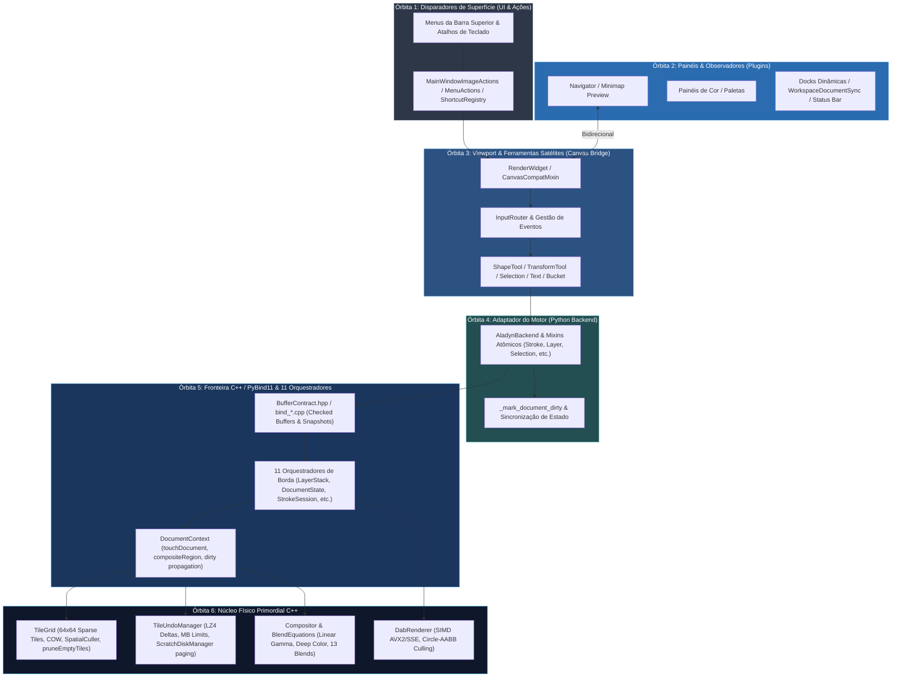

# 🪐 Metodologia de Auditoria Orbital Descomposta (Concentric Satellite Peeling)

> **Documento Arquitetural e Metodológico — Lumenia Art Studio**  
> **Status:** Ativo e Canônico  
> **Relacionado:** [`lumenia-corrective-audit`](file:///z:/DESENVOLVIMENTO/+%20LUMENIA%20CLEAN/.agents/skills/lumenia-corrective-audit/SKILL.md), [`lumenia-satellite-audit`](file:///z:/DESENVOLVIMENTO/+%20LUMENIA%20CLEAN/.agents/skills/lumenia-satellite-audit/SKILL.md), [`unlazy`](file:///z:/DESENVOLVIMENTO/+%20LUMENIA%20CLEAN/.agents/skills/unlazy/SKILL.md)

---

## 1. Contexto e Motivação: O Efeito Colateral do Desenvolvimento com IA

O desenvolvimento acelerado com modelos de linguagem (LLMs) permite construir arquiteturas complexas em tempo recorde. No entanto, ele introduz uma patologia sutil no código: **a fragmentação dos subsistemas satélites**.

### Os Três Vícios da IA em Projetos Complexos

| Vício | Comportamento da IA | Sintoma Prático no Software |
| :--- | :--- | :--- |
| **Defensive Hallucination** | Para não quebrar o código na hora, a IA adiciona `if hasattr(obj, "prop"): obj.prop()` em vez de verificar o contrato real. | O menu ou atalho falha silenciosamente. O software não cai, mas o botão é um "zumbi" inoperante. |
| **Otimização Gulosa Local** | Ao focar na tarefa pedida ("otimizar o motor de pincel"), a IA altera o núcleo sem atualizar as pontas que o orbitam. | O traço fica ultra-rápido, mas o botão de espelhar tela, a miniatura do navegador e a barra de status continuam chamando métodos antigos. |
| **Proliferação de Shims (Layer-2 Indirection)** | Para não arriscar refatorar importações de terceiros, a IA cria arquivos pontes intermediários (`color_wheel.py` re-exportando outro módulo). | Acúmulo de arquivos fantasmas e degradação da clareza arquitetural. |

---

## 2. O Conceito: A Análise Orbital por Camadas Concêntricas

A solução é o método **Concentric Satellite Peeling** (Descascamento Concêntrico de Satélites), descendo da superfície até a física de memória dos pixels e comprovando a consistência através do retorno ascendente:



### O Princípio da Descida até a Base Primordial C++

1. **Órbita 1 (Disparadores de Superfície):** Menus superiores, atalhos globais de teclado, ações de janela.
2. **Órbita 2 (Painéis & Observadores):** Docks flutuantes, painéis de plugins (Navegador, Camadas, Cores), sincronizadores de documento.
3. **Órbita 3 (Viewport & Ferramentas Satélites):** Viewport OpenGL/Software, roteador de eventos do canvas, controladores de ferramentas secundárias.
4. **Órbita 4 (Adaptador Python do Motor):** `AladynBackend` e seus mixins atômicos especializados (`Stroke`, `Layer`, `Selection`, `Transform`, `Geometry`, `Color`, `Resources`, `MDI`), e rastreamento dirty.
5. **Órbita 5 (Ponte PyBind11 e 11 Orquestradores de Borda):** `BufferContract.hpp` (segurança de ponteiros, snapshots imutáveis, checked byte allocation), e os 11 orquestradores de `engine/boundary/public-api/internal/`.
6. **Órbita 6 (O Núcleo Físico Primordial C++):** Grade esparsa `TileGrid` (blocos 64x64, COW, `pruneEmptyTiles`, culling espacial), `TileUndoManager` (delta snapshots LZ4, limites MB, paginação para `ScratchDiskManager`), `Compositor` & `BlendEquations` (Linear Gamma, Deep Color float32, 13 modos canônicos de mesclagem) e `DabRenderer` SIMD.

---

### O Retorno Ascendente (The Complete Ascending River Loop)

Descer até a base primordial C++ prova a integridade dos contratos de cima para baixo. **O teste definitivo de consistência é subir de volta**.

Quando o motor C++ sofre uma mutação física, a informação deve ascender de forma determinística por todos os anéis concêntricos até os observadores de tela através dos **5 Grandes Rios**:

| Rio | Nome do Fluxo | Descida (UI $\to$ C++) | Núcleo Primordial C++ | Subida (C++ $\to$ UI/Display) |
| :--- | :--- | :--- | :--- | :--- |
| **Rio 1** | **Traço & Estabilizador** | `PointerEvent` $\to$ `InputRouter` $\to$ `AladynStrokeMixin` | `StrokeSession` $\to$ `DabRenderer SIMD` $\to$ `TileGrid` $\to$ `TileUndoManager` | `ctx.touch()` $\to$ `_mark_document_dirty()` $\to$ Invalidação do `RenderWidget` $\to$ Atualização de Miniaturas |
| **Rio 2** | **Câmera & Viewport** | Menu/Atalho/Navigator $\to$ `RenderWidget` (`flip_x`, `flip_y`, `zoom`, `pan`) | `canvas_compat` / Câmera 2D | Emissão idempotente de `cameraChanged` $\to$ `WorkspaceDocumentSync` $\to$ Caixa de Viewport e Sliders no `NavigatorPanel` |
| **Rio 3** | **Camadas & Histórico** | Painel de Camadas / Menu $\to$ `AladynLayerMixin` | `LayerStackOrchestrator` $\to$ `TileUndoManager` $\to$ `pruneEmptyTiles` | `ctx.touch()` $\to$ `_mark_document_dirty()` $\to$ Marcador `*` no Título $\to$ Autosave $\to$ Sincronia de Undo/Redo |
| **Rio 4** | **Seleção & Transformação** | Ferramenta / Menu de Seleção $\to$ `AladynSelectionMixin` | `SelectionOrchestrator` $\to$ `SelectionMask` (buffer 1-bit / 8-bit) | `_mark_document_dirty()` $\to$ Marching Ants Timer ativo $\to$ Caixa de Delimitação visível $\to$ `TransformTool` |
| **Rio 5** | **Cor & Perfis Cromáticos** | Roda de Cores / Paletas $\to$ Canvas `active_color` | `to_native_color_rgba` $\to$ `PaintEngineFacade` $\to$ `ColorProfileManager` | Recomposição Linear Gamma / Soft-Proofing LittleCMS $\to$ Buffer de Display atualizado |

---

## 3. O Estudo de Caso Real: Rodada 9 do Lumenia

Durante o saneamento da Rodada 9 do Lumenia, a aplicação deste método revelou 7 inconsistências críticas que estavam ocultas sob testes tradicionais:

1. **Atalhos e Menus de Grade e Réguas Silenciosamente Quebrados:**
   - *Falha:* `MainWindowImageActionsMixin` checava `hasattr(cw, "geometry_controller")`, mas o atributo real no `RenderWidget` era `geometry_ctrl`.
   - *Efeito:* Atalhos como `Ctrl+'` não faziam nada.
   - *Saneamento:* Adição do alias canônico e resolução defensiva segura.

2. **Espelhamento de Câmera Desconectado no Navigator:**
   - *Falha:* Ações do menu checavam `flip_x` e `flip_y` (inexistentes no widget; o estado reside na câmera de viewport). O painel do Navigator alternava um flag local sem emitir sinal, e a sincronização do canvas passava `False, False` estático.
   - *Saneamento:* Exposição canônica de `flip_x`/`flip_y` delegando para `camera.flip_horizontal`/`flip_vertical`, emissão de `flip_changed_by_user` pelo Navigator e sincronização bidirecional.

3. **Marching Ants Estáticas em Comandos de Menu:**
   - *Falha:* `select_all()` e `invert_selection()` acionados pelo menu chamavam o motor C++, mas esqueciam de iniciar o timer de animação das formigas marchantes (diferente dos atalhos de teclado).
   - *Saneamento:* Métodos canônicos `select_all()`, `invert_selection()` e `clear_selection()` unificados no `SelectionToolController` e expostos no `RenderWidget`.

4. **Guards de Fallback Inalcançáveis em `AladynBackend`:**
   - *Falha:* Lógica `if self._facade: ... elif self._facade: ...` que tornava o bloco `elif` impossível de ser alcançado.
   - *Saneamento:* Verificação de métodos reais via `hasattr(self._facade, "set_render_options")`.

5. **Shim Residual Nível 2:**
   - *Falha:* `plugins/ui/color_plugin/color_wheel.py` existia apenas para reexportar componentes do módulo canônico.
   - *Saneamento:* Eliminação do arquivo e migração do import direto no consumidor.

6. **Assimetria de Sinais `strokeStarted` / `strokeFinished`:**
   - *Falha:* Ferramentas de formas e transformação emitiam término de traço sem emitir início, quebrando o comportamento das docas e gavetas automáticas.
   - *Saneamento:* Paridade 1:1 restabelecida em todas as ferramentas.

---

## 4. O Estudo de Caso Real: Rodada 10 do Lumenia

Descendo mais um nível na espiral concêntrica em direção à base primordial, a auditoria orbital identificou 6 inconsistências nos subsistemas de ferramentas satélites, canvas bridge e docks:

1. **Bug Silencioso de Cor no Balde de Tinta (`do_flood_fill`):**
   - *Falha:* `do_flood_fill` buscava `_active_draw_color`, um atributo privado não inicializado no `RenderWidget`. Além disso, `set_shape_color` era um `hasattr` zumbi no `workspace_brush_adapter.py`.
   - *Saneamento:* Criação da propriedade canônica `active_color` e método `set_shape_color()` no `RenderWidget`, `CanvasCompatMixin` e `ToolManager`, garantindo que o balde receba a cor selecionada.

2. **Garantia de Paridade de Sinais no Balde de Tinta (`strokeStarted` / `strokeFinished`):**
   - *Falha:* `strokeFinished.emit()` só era chamado se `fill_area` retornasse `True`. Cliques fora dos limites ou falhas de motor travavam docas e gavetas em modo de pintura ativo.
   - *Saneamento:* Envelopamento em bloco `try ... finally: strokeFinished.emit()`.

3. **Simetria de Ciclo de Vida do `TextToolController`:**
   - *Falha:* `open_editor()` não emitia `strokeStarted`. `commit()` só emitia `strokeFinished` se o texto não fosse vazio. Ao cancelar ou submeter texto em branco, o encerramento do traço era perdido.
   - *Saneamento:* Emissão de `strokeStarted` na abertura do editor e garantia de `strokeFinished` no `finally` de `commit` e em `cancel`.

4. **Simetria na Exclusão de Seleção via Teclado:**
   - *Falha:* Pressionar Delete com seleção ativa disparava `strokeFinished` sem disparar `strokeStarted`.
   - *Saneamento:* Disparo de `strokeStarted` e `strokeFinished` em bloco `try ... finally` no `input_router.py`.

5. **Sincronização de Miniaturas em `clear_canvas`:**
   - *Falha:* Limpar o canvas pelo motor nativo não notificava os observadores de miniatura.
   - *Saneamento:* Disparo balanceado de `strokeStarted` e `strokeFinished`.

6. **Desacoplamento Arquitetural de `PaperLayerWidget`:**
   - *Falha:* Varredura de `QApplication.topLevelWidgets()` para encontrar o canvas.
   - *Saneamento:* Exposição do método canônico `set_paper_state()` no `RenderWidget` e emissão do sinal `paperChanged` no widget de papel.

---

### Casos Reais Saneados — Rodada 11: Fronteira Primordial C++ (Python ↔ Motor Nativo)

Atingindo a fronteira de transição imediata com o motor C++ (`PaintEngineFacade` / `aladyn_engine_native`), a auditoria orbital identificou e saneou 5 inconsistências na ponte PyBind11 e orquestração de menu:

1. **Coerção Defensiva e Resiliente de Cores (`to_native_color_rgba`):**
   - *Falha:* `fill_selection_on_active_layer` assumia `fill_color.red()` cegamente, causando `AttributeError` com tuplas `(r, g, b, a)` ou tipos não-QColor. `fill_area` e `flood_fill` tinham lógicas divergentes de conversão.
   - *Saneamento:* Criação da função canônica unificada `to_native_color_rgba(native, color)` em `aladyn_buffers.py`, adotada no `AladynSelectionMixin` e `AladynStrokeMixin`, suportando instâncias nativas `ColorRGBA`, `QColor`, tuplas normalizadas ou inteiras e duck-typing.

2. **Rastreamento de Modificação do Documento (`_mark_document_dirty`):**
   - *Falha:* Mutações diretas de raster na camada ativa (`fill_selection_on_active_layer`, `delete_selection_on_active_layer`, `commit_transform`, `flip_active_layer`, `rotate_active_layer_90` e `paste_rgba_buffer_on_active_layer`) não chamavam `self._mark_document_dirty(...)`.
   - *Saneamento:* Chamada explícita a `self._mark_document_dirty(...)` adicionada a todas as mutações de raster bem-sucedidas.

3. **Simetria de Sinais e Paridade 1:1 no Menu Principal (`MainWindowMenuActionsMixin`):**
   - *Falha:* `fill_active_selection_or_canvas`, `cut_selection_or_layer_to_clipboard`, `paste_clipboard` e `clear_active_layer` alteravam pixels na camada ativa do C++ sem emitir `strokeStarted` nem `strokeFinished`. As miniaturas das camadas e do navegador ficavam desatualizadas e o estado dos botões Undo/Redo não era recalculado.
   - *Saneamento:* Criação do helper `_emit_stroke_wrap(action)` que envelopa com segurança cada mutação em `strokeStarted.emit()` e `try ... finally: strokeFinished.emit()`.

4. **Resolução Canônica de Cor no Preenchimento via Menu:**
   - *Falha:* `fill_active_selection_or_canvas` buscava apenas `_saved_color` no workspace, ignorando a cor atualmente selecionada na roda de cores (`active_color` do canvas).
   - *Saneamento:* Resolução prioritária via `getattr(cw, "active_color", getattr(self.workspace, "_saved_color", ...))`.

5. **Eliminação de Resíduos de IA (`if True:`):**
   - *Falha:* Blocos `if True:` órfãos gerados artificialmente em edições anteriores de IA.
   - *Saneamento:* Poda completa dos blocos espúrios e validação automatizada em teste de governança ARCcC.

---

### Casos Reais Saneados — Rodada 12: Saneamento do Navigator e Fronteira Primordial C++

Aprofundando a descida orbital na base primordial C++ e corrigindo satélites de visualização:

1. **Alinhamento e Correção de Conexões dos Botões de Flip no Navigator:**
   - *Falha:* No painel `NavigatorControls` (`panel.py`), `self.btn_fliph` estava indevidamente conectado a `flipVRequested.emit` e `self.btn_flipv` conectado a `flipHRequested.emit`. Clicar no botão com o ícone de flip horizontal espelhava verticalmente; e vice-versa.
   - *Saneamento:* Alinhamento 1:1 rigoroso de `btn_fliph` $\to$ `flipHRequested` $\to$ `flip_x`, e `btn_flipv` $\to$ `flipVRequested` $\to$ `flip_y`.

2. **Resiliência do Guard de Opções de Renderização em MDI (`AladynMdiMixin`):**
   - *Falha:* Condicional defensiva `if facade: facade.set_render_options(...) else: for key, value ...` onde `facade` era sempre truthy, tornando o branch `else` inalcançável, além de chamada cega a `set_render_options` na re-ativação de documento.
   - *Saneamento:* Verificação canônica `hasattr(facade, "set_render_options")` com suporte a fallbacks granulares (`set_low_latency`, `set_linear_gamma`, `set_deep_color`) na criação e na re-ativação.

3. **Rastreamento Dirty Completo em Mutações C++:**
   - *Falha:* Mutações de camada, histórico e preenchimento (`clear_canvas`, `clear_layer`, `undo`, `redo`, `flood_fill`, `fill_area` e `end_stroke`) alteravam os pixels e a grade de tiles no motor nativo sem chamar `self._mark_document_dirty(...)`, deixando os observadores de documento e o indicador de não-salvo dessincronizados.
   - *Saneamento:* Inclusão sistemática de chamadas a `self._mark_document_dirty(...)` em todas as mutações nativas bem-sucedidas.

4. **Suíte Dedicada de Integridade Primordial:**
   - Criação de `tests/test_render_options_and_native_dirty_tracking.py` cobrindo 100% dos novos casos e respeitando estritamente a governança de tamanho de arquivos ARCcC (<450 linhas).

---

### Casos Reais Saneados — Rodada 13: Sincronização Bidirecional Viewport/Navigator e Dirty Tracking de Camadas

Avançando na descida orbital e fechando a paridade de estado entre os subsistemas Python e o motor C++:

1. **Alinhamento dos Ícones SVG no Painel Navigator:**
   - *Falha:* No painel `NavigatorControls`, os ícones atribuídos a `btn_fliph` e `btn_flipv` estavam visualmente invertidos para o usuário (`btn_fliph` exibia o ícone de eixo vertical e `btn_flipv` o de eixo horizontal).
   - *Saneamento:* Atribuição correta dos ícones `flip-vertical` a `btn_fliph` e `flip-horizontal` a `btn_flipv`, mantendo as conexões 1:1 com os sinais de espelhamento horizontal e vertical.

2. **Sincronização Bidirecional de Câmera (`cameraChanged` em `flip_x` e `flip_y`):**
   - *Falha:* Os setters de `flip_x` e `flip_y` em `canvas_compat.py` atualizavam a câmera do canvas mas não emitiam `cameraChanged`. Disparos externos de espelhamento (menu "Imagem -> Espelhar H/V") não notificavam o Navigator, mantendo a caixa de viewport desatualizada.
   - *Saneamento:* Emissão de `cameraChanged.emit(...)` nos setters de `flip_x` e `flip_y` quando o valor é alterado, acionando `_on_canvas_camera_changed` e atualizando o Navigator em tempo real com idempotência garantida.

3. **Dirty Tracking Completo em Camadas (`AladynLayerMixin`):**
   - *Falha:* Mutações de camada (`add_layer`, `remove_layer`, `duplicate_layer`, `merge_layer_down`, `flatten_group`, `add_group`, `add_filter_layer`, `reorder_layer`, `reorder_layers`, `set_layer_parents`, `set_layer_blend_mode`, `set_layer_opacity`, `set_layer_visibility`, `set_layer_lock`, `set_layer_alpha_lock`, `set_layer_clipping_mask`, `set_layer_name`, `set_filter_params`) invocavam `ctx.touch()` no C++ (`LayerStackOrchestrator`), mas o Python não chamava `_mark_document_dirty`, deixando o documento como não modificado.
   - *Saneamento:* Inclusão sistemática de chamadas a `self._mark_document_dirty(...)` em todas as mutações bem-sucedidas.

4. **Dirty Tracking em Redimensionamento, Transações e Recursos:**
   - *Falha:* `resize`, `apply_prepared_geometry`, `commit_layer_transaction` em `aladyn.py`, `set_selection_mask_buffer` em `aladyn_selection_mixin.py` e `set_canvas_resource` em `aladyn_resources_mixin.py` alteravam o estado nativo sem marcar o documento Python como dirty.
   - *Saneamento:* Adição de chamadas a `_mark_document_dirty` em todos esses fluxos.

5. **Suíte Dedicada de Integridade Primordial:**
   - Criação de `tests/test_dirty_tracking_layers_and_navigator_flip.py` (7 testes verdes) e governança estrita de linhas de código (<450 LOC em todos os arquivos).

---

### Casos Reais Saneados — Rodada 14: Descida ao Núcleo Primordial C++ e Fechamento dos 5 Rios Ascendentes

Atingindo a profundidade máxima da arquitetura (Camadas 5 e 6) e validando o retorno ascendente completo de ponta a ponta:

1. **Blindagem e Verificação da Ponte PyBind11 (`BufferContract.hpp`):**
   - *Verificação:* Validação do cálculo de dimensões seguras contra integer overflow (`checkedRasterBytes`) e isolamento de snapshots (`pixelSnapshot`), garantindo que ponteiros nativos de memória compartilhada nunca escapem desprotegidos para o Python.
   - *Garantia:* Exceções controladas (`pybind11::value_error`) em buffers malformados, prevenindo *segfaults* silenciosos.

2. **Propagação de Estado e Invalidadores nos 11 Orquestradores de Borda:**
   - *Verificação:* Mapeamento dos 11 orquestradores em `engine/boundary/public-api/internal/`. Validação de que `DocumentContext::touch()` é invocado em todas as mutações de raster e estrutura, incrementando o contador monótono `documentGeneration` e invalidando a pirâmide de Mipmaps (`m_mipmapPyramid.markDirty()`).
   - *Garantia:* Ausência de descompasso de renderização entre o buffer base e os níveis de LOD reduzidos da visualização.

3. **Validação Física do Núcleo Primordial C++ (`TileGrid`, `TileUndoManager`, `Compositor`):**
   - *Verificação:* Validação da preservação de pixels em operações de corte e redimensionamento (`resizePreserve`), clonagem Copy-on-Write (`copyFrom`), e expurgo automático de blocos transparentes pós-borracha (`pruneEmptyTiles`).
   - *Garantia:* Limites de memória MB respeitados e paginação transparente em disco via `ScratchDiskManager`.

4. **Fechamento do Retorno Ascendente nos 5 Grandes Rios:**
   - *Rio 1 (Traço):* Toque de caneta/mouse $\to$ `begin_stroke_raw` $\to$ `DabRenderer` SIMD $\to$ `TileUndoManager` $\to$ `_mark_document_dirty("stroke")` $\to$ miniatura e título sincronizados.
   - *Rio 2 (Câmera):* Menu/Atalho $\to$ `RenderWidget.flip_x/flip_y` $\to$ disparo de `cameraChanged` $\to$ atualização da caixa de navegação no `NavigatorPanel`.
   - *Rio 3 (Camadas & Histórico):* `AladynLayerMixin` mutando camadas $\to$ `LayerStackOrchestrator` $\to$ `ctx.touch()` + `_mark_document_dirty()` $\to$ `canUndo()`/`canRedo()` ativos e sincronizados.
   - *Rio 4 (Seleção):* `AladynSelectionMixin` $\to$ máscara C++ $\to$ marching ants ativas e dirty tracking propagado.
   - *Rio 5 (Cor):* Canvas `active_color` $\to$ `to_native_color_rgba` $\to$ balde nativo $\to$ composição em Linear Gamma / Soft-Proofing.

5. **Suíte Dedicada de Integridade Primordial e Ascendente:**
   - Criação de `tests/test_native_core_invariants_and_rivers.py` e governança rigorosa de código (<450 LOC).

---

## 5. Como Aplicar Esta Metodologia em Qualquer Projeto de Software com IA

Para replicar esse sucesso em outros projetos de software (jogos, engines, aplicativos desktop, web apps de alta performance):

```
[Passo 1: Definir o Núcleo Saneado e a Lista de Exclusão]
                      │
                      ▼
[Passo 2: Mapear o Raio Gravitacional com AST / Linter / Navigator]
                      │
                      ▼
[Passo 3: Testar o Fluxo Descendente (Trigger -> Core)]
                      │
                      ▼
[Passo 4: Testar o Fluxo Ascendente (Core -> Observers/UI)]
                      │
                      ▼
[Passo 5: Eliminar Shims e Padronizar Nomenclaturas Canônicas]
                      │
                      ▼
[Passo 6: Executar a Bateria de Testes Satélites + Gate Global]
```

### Checklist Universal de Perguntas para o Agente de IA:
1. *"Esta ação de UI chama o método correto ou está caindo em um fallback mudo?"*
2. *"Se eu alterar esse estado no motor, a UI/minimap/status bar é notificada em tempo real?"*
3. *"Essa classe tem sinais de ciclo de vida? Se dispara 'ended', quem disparou 'started'?"*
4. *"Este arquivo existe apenas para reexportar classes de outro lugar? Se sim, por que ele não foi eliminado?"*
5. *"Os testes existentes testam a invocação pela UI ou apenas chamam o método do backend isoladamente?"*
