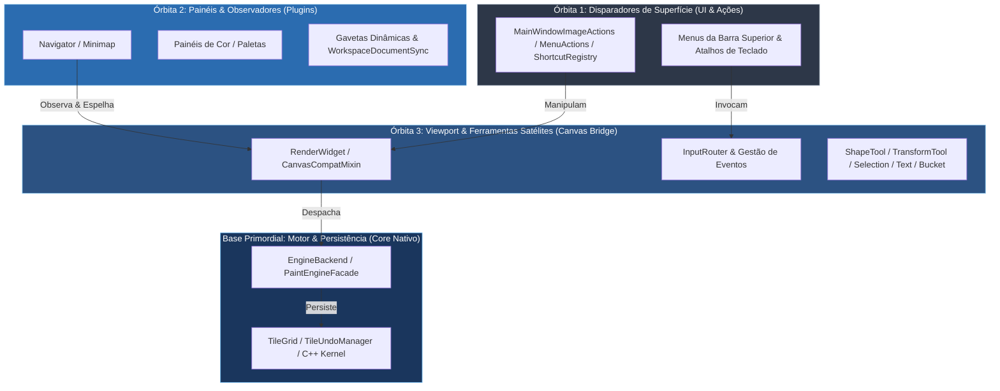

# 🪐 Metodologia de Auditoria Orbital Descomposta (Concentric Satellite Peeling)

> **Documento Arquitetural e Metodológico — Lumenia Art Studio**  
> **Status:** Ativo e Canônico  
> **Relacionado:** [`lumenia-corrective-audit`](file:///z:/DESENVOLVIMENTO/+%20LUMENIA%20CLEAN/.agents/skills/lumenia-corrective-audit/SKILL.md), [`lumenia-satellite-audit`](file:///z:/DESENVOLVIMENTO/+%20LUMENIA%20CLEAN/.agents/skills/lumenia-satellite-audit/SKILL.md), [`unlazy`](file:///z:/DESENVOLVIMENTO/+%20LUMENIA%20CLEAN/.agents/skills/unlazy/SKILL.md)

---

## 1. Contexto e Motivação: O Efeito Colateral do Desenvolvimento com IA

O desenvolvimento acelerado com modelos de linguagem (LLMs) permite construir arquiteturas complexas em tempo recorde. No entanto, ele introduz uma patologia sutil no código: **a fragmentação dos subsistemas satélites**.

### Os Três Vícios da IA em Projetos Complexos

| Vício | Comportamento da IA | Sintoma Prático no Software |
| :--- | :--- | :--- |
| **Defensive Hallucination** | Para não quebrar o código na hora, a IA adiciona `if hasattr(obj, "prop"): obj.prop()` em vez de verificar o contrato real. | O menu ou atalho falha silenciosamente. O software não cai, mas o botão é um "zumbi" inoperante. |
| **Otimização Gulosa Local** | Ao focar na tarefa pedida ("otimizar o motor de pincel"), a IA altera o núcleo sem atualizar as pontas que o orbitam. | O traço fica ultra-rápido, mas o botão de espelhar tela, a miniatura do navegador e a barra de status continuam chamando métodos antigos. |
| **Proliferação de Shims (Layer-2 Indirection)** | Para não arriscar refatorar importações de terceiros, a IA cria arquivos pontes intermediários (`color_wheel.py` re-exportando outro módulo). | Acúmulo de arquivos fantasmas e degradação da clareza arquitetural. |

---

## 2. O Conceito: A Análise Orbital por Camadas Concêntricas

A solução é o método **Concentric Satellite Peeling** (Descascamento Concêntrico de Satélites):



### O Princípio da Descida até a Base Primordial

1. **Camada Externa (Superfície):** Menus superiores, atalhos globais, diálogos de entrada.
2. **Camada Intermediária (Satélites):** Docks, painéis de plugins (Navegador, Camadas, Cores), sincronizadores de documento.
3. **Camada de Orquestração (Ponte):** Viewport, roteador de eventos do canvas, controladores de ferramentas secundárias.
4. **Base Primordial (Núcleo):** O motor de renderização, gerenciador de tiles em C++, matrizes de pixels e buffers de memória.

---

## 3. O Estudo de Caso Real: Rodada 9 do Lumenia

Durante o saneamento da Rodada 9 do Lumenia, a aplicação deste método revelou 7 inconsistências críticas que estavam ocultas sob testes tradicionais:

1. **Atalhos e Menus de Grade e Réguas Silenciosamente Quebrados:**
   - *Falha:* `MainWindowImageActionsMixin` checava `hasattr(cw, "geometry_controller")`, mas o atributo real no `RenderWidget` era `geometry_ctrl`.
   - *Efeito:* Atalhos como `Ctrl+'` não faziam nada.
   - *Saneamento:* Adição do alias canônico e resolução defensiva segura.

2. **Espelhamento de Câmera Desconectado no Navigator:**
   - *Falha:* Ações do menu checavam `flip_x` e `flip_y` (inexistentes no widget; o estado reside na câmera de viewport). O painel do Navigator alternava um flag local sem emitir sinal, e a sincronização do canvas passava `False, False` estático.
   - *Saneamento:* Exposição canônica de `flip_x`/`flip_y` delegando para `camera.flip_horizontal`/`flip_vertical`, emissão de `flip_changed_by_user` pelo Navigator e sincronização bidirecional.

3. **Marching Ants Estáticas em Comandos de Menu:**
   - *Falha:* `select_all()` e `invert_selection()` acionados pelo menu chamavam o motor C++, mas esqueciam de iniciar o timer de animação das formigas marchantes (diferente dos atalhos de teclado).
   - *Saneamento:* Métodos canônicos `select_all()`, `invert_selection()` e `clear_selection()` unificados no `SelectionToolController` e expostos no `RenderWidget`.

4. **Guards de Fallback Inalcançáveis em `AladynBackend`:**
   - *Falha:* Lógica `if self._facade: ... elif self._facade: ...` que tornava o bloco `elif` impossível de ser alcançado.
   - *Saneamento:* Verificação de métodos reais via `hasattr(self._facade, "set_render_options")`.

5. **Shim Residual Nível 2:**
   - *Falha:* `plugins/ui/color_plugin/color_wheel.py` existia apenas para reexportar componentes do módulo canônico.
   - *Saneamento:* Eliminação do arquivo e migração do import direto no consumidor.

6. **Assimetria de Sinais `strokeStarted` / `strokeFinished`:**
   - *Falha:* Ferramentas de formas e transformação emitiam término de traço sem emitir início, quebrando o comportamento das docas e gavetas automáticas.
   - *Saneamento:* Paridade 1:1 restabelecida em todas as ferramentas.

---

## 4. O Estudo de Caso Real: Rodada 10 do Lumenia

Descendo mais um nível na espiral concêntrica em direção à base primordial, a auditoria orbital identificou 6 inconsistências nos subsistemas de ferramentas satélites, canvas bridge e docks:

1. **Bug Silencioso de Cor no Balde de Tinta (`do_flood_fill`):**
   - *Falha:* `do_flood_fill` buscava `_active_draw_color`, um atributo privado não inicializado no `RenderWidget`. Além disso, `set_shape_color` era um `hasattr` zumbi no `workspace_brush_adapter.py`.
   - *Saneamento:* Criação da propriedade canônica `active_color` e método `set_shape_color()` no `RenderWidget`, `CanvasCompatMixin` e `ToolManager`, garantindo que o balde receba a cor selecionada.

2. **Garantia de Paridade de Sinais no Balde de Tinta (`strokeStarted` / `strokeFinished`):**
   - *Falha:* `strokeFinished.emit()` só era chamado se `fill_area` retornasse `True`. Cliques fora dos limites ou falhas de motor travavam docas e gavetas em modo de pintura ativo.
   - *Saneamento:* Envelopamento em bloco `try ... finally: strokeFinished.emit()`.

3. **Simetria de Ciclo de Vida do `TextToolController`:**
   - *Falha:* `open_editor()` não emitia `strokeStarted`. `commit()` só emitia `strokeFinished` se o texto não fosse vazio. Ao cancelar ou submeter texto em branco, o encerramento do traço era perdido.
   - *Saneamento:* Emissão de `strokeStarted` na abertura do editor e garantia de `strokeFinished` no `finally` de `commit` e em `cancel`.

4. **Simetria na Exclusão de Seleção via Teclado:**
   - *Falha:* Pressionar Delete com seleção ativa disparava `strokeFinished` sem disparar `strokeStarted`.
   - *Saneamento:* Disparo de `strokeStarted` e `strokeFinished` em bloco `try ... finally` no `input_router.py`.

5. **Sincronização de Miniaturas em `clear_canvas`:**
   - *Falha:* Limpar o canvas pelo motor nativo não notificava os observadores de miniatura.
   - *Saneamento:* Disparo balanceado de `strokeStarted` e `strokeFinished`.

6. **Desacoplamento Arquitetural de `PaperLayerWidget`:**
   - *Falha:* Varredura de `QApplication.topLevelWidgets()` para encontrar o canvas.
   - *Saneamento:* Exposição do método canônico `set_paper_state()` no `RenderWidget` e emissão do sinal `paperChanged` no widget de papel.

---

### Casos Reais Saneados — Rodada 11: Fronteira Primordial C++ (Python ↔ Motor Nativo)

Atingindo a fronteira de transição imediata com o motor C++ (`PaintEngineFacade` / `aladyn_engine_native`), a auditoria orbital identificou e saneou 5 inconsistências na ponte PyBind11 e orquestração de menu:

1. **Coerção Defensiva e Resiliente de Cores (`to_native_color_rgba`):**
   - *Falha:* `fill_selection_on_active_layer` assumia `fill_color.red()` cegamente, causando `AttributeError` com tuplas `(r, g, b, a)` ou tipos não-QColor. `fill_area` e `flood_fill` tinham lógicas divergentes de conversão.
   - *Saneamento:* Criação da função canônica unificada `to_native_color_rgba(native, color)` em `aladyn_buffers.py`, adotada no `AladynSelectionMixin` e `AladynStrokeMixin`, suportando instâncias nativas `ColorRGBA`, `QColor`, tuplas normalizadas ou inteiras e duck-typing.

2. **Rastreamento de Modificação do Documento (`_mark_document_dirty`):**
   - *Falha:* Mutações diretas de raster na camada ativa (`fill_selection_on_active_layer`, `delete_selection_on_active_layer`, `commit_transform`, `flip_active_layer`, `rotate_active_layer_90` e `paste_rgba_buffer_on_active_layer`) não chamavam `self._mark_document_dirty(...)`.
   - *Saneamento:* Chamada explícita a `self._mark_document_dirty(...)` adicionada a todas as mutações de raster bem-sucedidas.

3. **Simetria de Sinais e Paridade 1:1 no Menu Principal (`MainWindowMenuActionsMixin`):**
   - *Falha:* `fill_active_selection_or_canvas`, `cut_selection_or_layer_to_clipboard`, `paste_clipboard` e `clear_active_layer` alteravam pixels na camada ativa do C++ sem emitir `strokeStarted` nem `strokeFinished`. As miniaturas das camadas e do navegador ficavam desatualizadas e o estado dos botões Undo/Redo não era recalculado.
   - *Saneamento:* Criação do helper `_emit_stroke_wrap(action)` que envelopa com segurança cada mutação em `strokeStarted.emit()` e `try ... finally: strokeFinished.emit()`.

4. **Resolução Canônica de Cor no Preenchimento via Menu:**
   - *Falha:* `fill_active_selection_or_canvas` buscava apenas `_saved_color` no workspace, ignorando a cor atualmente selecionada na roda de cores (`active_color` do canvas).
   - *Saneamento:* Resolução prioritária via `getattr(cw, "active_color", getattr(self.workspace, "_saved_color", ...))`.

5. **Eliminação de Resíduos de IA (`if True:`):**
   - *Falha:* Blocos `if True:` órfãos gerados artificialmente em edições anteriores de IA.
   - *Saneamento:* Poda completa dos blocos espúrios e validação automatizada em teste de governança ARCcC.

---

## 5. Como Aplicar Esta Metodologia em Qualquer Projeto de Software com IA

Para replicar esse sucesso em outros projetos de software (jogos, engines, aplicativos desktop, web apps de alta performance):

```
[Passo 1: Definir o Núcleo Saneado e a Lista de Exclusão]
                      │
                      ▼
[Passo 2: Mapear o Raio Gravitacional com AST / Linter / Navigator]
                      │
                      ▼
[Passo 3: Testar o Fluxo Descendente (Trigger -> Core)]
                      │
                      ▼
[Passo 4: Testar o Fluxo Ascendente (Core -> Observers/UI)]
                      │
                      ▼
[Passo 5: Eliminar Shims e Padronizar Nomenclaturas Canônicas]
                      │
                      ▼
[Passo 6: Executar a Bateria de Testes Satélites + Gate Global]
```

### Checklist Universal de Perguntas para o Agente de IA:
1. *"Esta ação de UI chama o método correto ou está caindo em um fallback mudo?"*
2. *"Se eu alterar esse estado no motor, a UI/minimap/status bar é notificada em tempo real?"*
3. *"Essa classe tem sinais de ciclo de vida? Se dispara 'ended', quem disparou 'started'?"*
4. *"Este arquivo existe apenas para reexportar classes de outro lugar? Se sim, por que ele não foi eliminado?"*
5. *"Os testes existentes testam a invocação pela UI ou apenas chamam o método do backend isoladamente?"*
