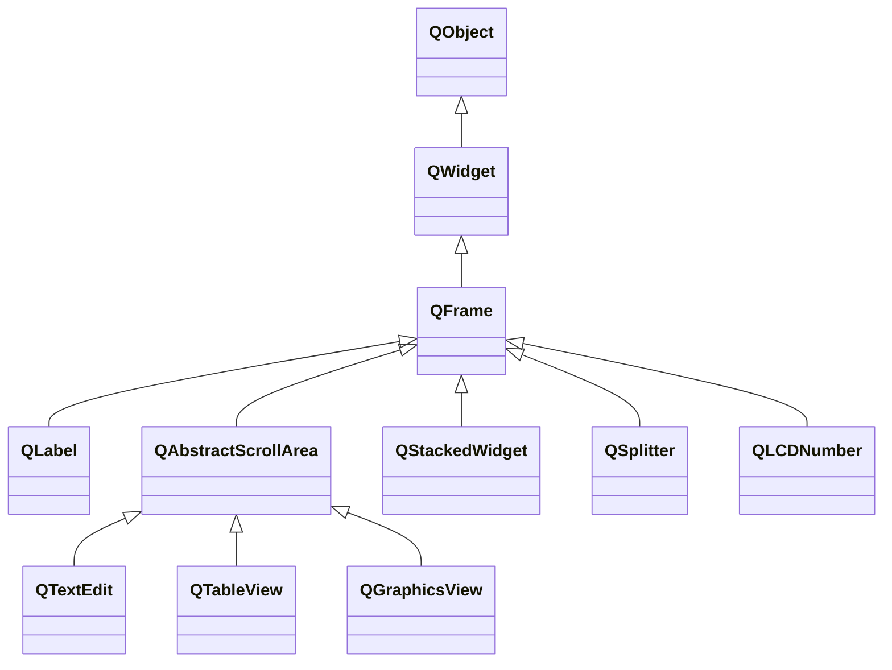

# Guia Técnico: A Armadilha de Herança do QFrame sobre QLabel em Qt / PySide

> **Referência Rápida para Desenvolvedores de UI no Lumenia**  
> **Tema:** Herança de estilos QSS, especificidade de seletores e isolamento visual de componentes.

---

## 1. O Problema Visual (Sintoma Típico)

Ao construir interfaces modernas em Qt (como barras flutuantes, cards, HUDs e painéis), é comum adicionar um divisor de linha ou estilizar um container usando `QFrame`.

De repente, rótulos de texto, ícones vetoriais ou contadores (`QLabel`) que deveriam ter fundo transparente passam a exibir **blocos retangulares coloridos indesejados** (vazamento de fundo) atrás do texto:

```
┌────────────────────────────────────────────────────────┐
│  [ | ]  [ ██ REC ██ ]  [ ██ 00:00:03 ██ ]   |   ⏸   ⏹  │  <-- Blocos indesejados
└────────────────────────────────────────────────────────┘
```

---

## 2. A Causa Raiz: A Árvore de Classes C++ do Qt

Diferente do CSS padrão da web (onde `<div>` e `<p>` são tags completamente separadas e sem herança de tipo), o **Qt Style Sheets (QSS)** opera sobre a hierarquia de tipos em C++ do framework Qt.

Na arquitetura do Qt, **`QLabel` herda diretamente de `QFrame`**:



### Por que isso é perigoso no QSS?
Quando você declara em uma folha de estilos:
```css
QFrame {
    background-color: #30363d;
}
```
Pelo mecanismo do Qt, o seletor `QFrame` corresponde a **qualquer widget que seja uma instância de `QFrame` OU de qualquer uma de suas subclasses**.

Como `QLabel` é uma subclasse de `QFrame`, **todo `QLabel` dentro daquele container se torna um alvo da regra** e passa a desenhar o fundo de cor `#30363d` atrás do seu texto.

---

## 3. Seletores de Tipo vs. Seletores de Instância Exata

O Qt possui um recurso poderoso e pouco documentado para resolver exatamente isso: o **seletor com ponto (`.`)**:

| Seletor | O que afeta | Exemplo |
| :--- | :--- | :--- |
| `QFrame` | Instâncias de `QFrame` **e todas as suas subclasses** (`QLabel`, `QTextEdit`, etc.) | ⚠️ **Perigo de vazamento** |
| `.QFrame` | **Apenas** instâncias diretas da classe `QFrame` (ignora subclasses como `QLabel`) | ✅ **Seguro para divisores e cards** |
| `QFrame#MeuId` | Apenas a instância com o `objectName` correspondente | 🛡️ **Máxima segurança** |
| `QLabel` | Apenas instâncias de `QLabel` e subclasses diretas dela | ✅ **Específico para rótulos** |

---

## 4. Casos Clássicos de Anti-Patterns e Como Corrigir

### Caso 1: Divisores Verticais ou Horizontais (Separadores)

❌ **Anti-Pattern (Vaza estilo para todas as labels):**
```python
sep = QtWidgets.QFrame(container)
sep.setFrameShape(QtWidgets.QFrame.Shape.VLine)

# No CSS do container:
container.setStyleSheet("""
    QFrame {
        background-color: #404040;
    }
""")
```

✅ **Solução Recomendada (Uso de ID específico):**
```python
sep = QtWidgets.QFrame(container)
sep.setObjectName("BarSeparator")
sep.setFrameShape(QtWidgets.QFrame.Shape.VLine)

# No CSS do container:
container.setStyleSheet("""
    QFrame#BarSeparator {
        background-color: #404040;
        border: none;
    }
""")
```

---

### Caso 2: Containers de Card / Painel com `QFrame`

❌ **Anti-Pattern:**
```python
card = QtWidgets.QFrame(parent)
# CSS aplicado no card:
card.setStyleSheet("""
    QFrame {
        background-color: #202024;
        border: 1px solid #303038;
        border-radius: 8px;
    }
""")
# Qualquer QLabel filho desse card herdará as bordas e o background!
```

✅ **Solução A (Usar o seletor estrito com ponto `.QFrame`):**
```css
/* O ponto (.) restringe a regra à classe exata, sem propagar para QLabel */
.QFrame {
    background-color: #202024;
    border: 1px solid #303038;
    border-radius: 8px;
}
```

✅ **Solução B (Usar ID único no container):**
```python
card.setObjectName("SettingsCard")
```
```css
QFrame#SettingsCard {
    background-color: #202024;
    border: 1px solid #303038;
    border-radius: 8px;
}
```

---

### Caso 3: Pseudo-estados de Hover em Containers

❌ **Anti-Pattern:**
```css
QFrame:hover {
    background-color: #2a2a30;
}
/* Ao passar o mouse por cima do container, as labels internas
   podem piscar ou mudar de cor de fundo se o mouse estiver sobre elas! */
```

✅ **Solução:**
```css
QFrame#MyCard:hover {
    background-color: #2a2a30;
}
```

---

## 5. Boas Práticas e Regras de Ouro no Lumenia

1. **Blindagem Universal de `QLabel`:**
   Ao criar containers com estilos customizados, declare explicitamente:
   ```css
   QLabel {
       background-color: transparent;
       border: none;
   }
   ```
2. **Nomeie Sempre os Separadores:**
   Nunca use `QFrame` puro sem `objectName`. Sempre faça `sep.setObjectName("...")` e selecione por `QFrame#...`.
3. **Use `.QFrame` quando quiser estilizar a casca sem afetar o conteúdo:**
   O seletor `.Classe` no Qt impede a propagação para classes derivadas.
4. **Cuidado com outros herdeiros de `QFrame`:**
   Lembre-se que `QTextEdit`, `QListWidget`, `QTreeWidget` e `QStackedWidget` também herdam de `QFrame`. Regras genéricas `QFrame { ... }` afetam esses componentes se estiverem aninhados.

---

## 6. Checklist Rápido de Code Review

- [ ] Há algum seletor genérico `QFrame { ... }` sem `#ID` ou sem ponto `.`?
- [ ] Os divisores de linha possuem `setObjectName` explícito?
- [ ] O container possui `QLabel { background: transparent; }` declarado?
- [ ] O componente foi inspecionado em temas claros e escuros para verificar se textos não criam bordas ou caixas retangulares atrás de glifos?
