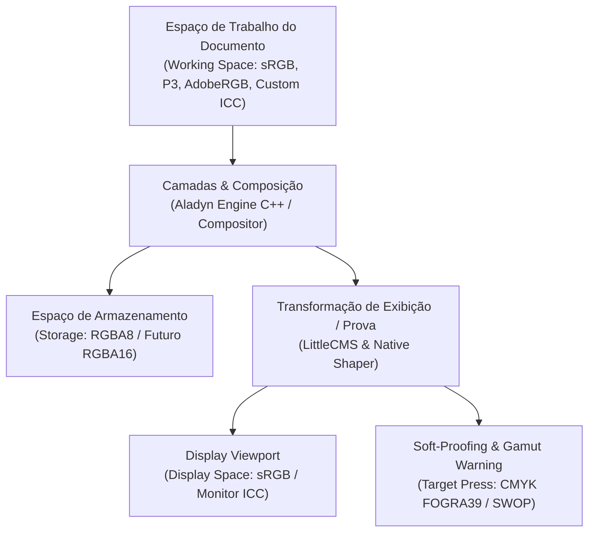

# 🎨 Arquitetura do Pipeline de Gestão Profissional de Cor & Alta Profundidade (F-006)

**Lumenia Art Studio & Aladyn Native Engine**  
*Data de Referência: Setembro de 2026*  
*Status: LittleCMS 2.x Integrado; SSOT C++ Unificada; Especificação de 16-bit / Float Definida.*

---

## 1. Visão Geral da Arquitetura

O ecossistema de cores do Lumenia separa rigorosamente quatro domínios conceituais:



1. **Espaço de Trabalho do Documento (*Working Color Space*)**:
   - Define a gama e primários cromáticos onde a pintura e mistura ocorrem.
   - Suporta os 14 perfis canônicos nativos do motor C++ ou perfis ICC arbitrários carregados pelo usuário (`.icc` / `.icm`).
2. **Espaço de Armazenamento (*Storage Space*)**:
   - Resolução física dos dados em memória e no arquivo `.lmn`.
   - Atualmente estabilizado em `RGBA8` (32 bits por pixel), com caminho planejado para `RGBA16` (64 bits por pixel) e `RGBA32F` (128 bits por pixel).
3. **Transformação de Exibição / Prova (*Display & Proofing Transform*)**:
   - Converte os dados do espaço de trabalho do documento para o espaço de exibição do monitor do usuário.
   - Quando o modo de **Soft-Proofing** está ativo, o pipeline LittleCMS simula o perfil de impressão de destino (ex: CMYK ISO Coated v2 / FOGRA39) com a intenção de renderização selecionada (*Perceptual*, *Relative Colorimetric*, *Saturation*, *Absolute Colorimetric*) e destaque de pixels fora de gama (*Gamut Warning*).
4. **Exportação Final de Imagem (*Asset Export*)**:
   - Arquivos finais gerados (`.png`, `.jpg`, `.tif`, `.webp`) incorporam o cabeçalho binário do perfil ICC ativo do documento, garantindo paridade em visualizadores de clientes, navegadores e RIPs gráficos de pré-impressão.

---

## 2. Catálogo Canônico Unificado & LittleCMS

A gestão de cor opera sob uma Fonte Única da Verdade (**SSOT**):
- **Perfis Nativos (IDs 0–13)**:
  - Implementados em C++ puro em `engine/core/color/ColorProfile.cpp` para transformações ultra-rápidas em tempo real no buffer de exibição do viewport.
- **Perfis Customizados e do Sistema (IDs $\ge 100$)**:
  - Descobertos a partir do spooler de cores do Windows (`C:\Windows\System32\spool\drivers\color`) ou importados diretamente pelo usuário.
  - Processados pelo motor `ColorManagementEngine` (`ui/core/color/cms_engine.py`) utilizando LittleCMS 2.18 via `PIL.ImageCms`.
  - Cache dinâmico de instâncias de `ImageCmsTransform` compiladas com flags de alta performance (`HIGHRESPRECALC`, `BLACKPOINTCOMPENSATION`).

---

## 3. Simulação de Prova de Cor (Soft-Proofing)

A prova de cor em tela permite que ilustradores e designers confiram como sua arte RGB será impressa em processos gráficos CMYK sem precisar exportar testes:

| Intenção de Renderização | Constante LittleCMS | Comportamento e Caso de Uso |
|---|:---:|---|
| **Colorimétrico Relativo (Padrão)** | `1` | Mapeia o ponto branco do documento para o ponto branco do papel; preserva cores dentro do gamut e ajusta as demais para a borda mais próxima. |
| **Perceptual (Fotográfico)** | `0` | Comprime proporcionalmente todo o gamut para manter as relações visuais entre as cores; ideal para ilustrações complexas com degradês sutis. |
| **Saturação** | `2` | Maximiza a vivacidade das cores em detrimento da precisão colorimétrica estrita; recomendado para infográficos e arte vetorial. |
| **Colorimétrico Absoluto** | `3` | Não adapta o ponto branco, simulando a tonalidade física exata do papel do substrato de impressão. |

- **Gamut Warning**: Quando ativado, os pixels cujo croma excede a capacidade física da tinta de impressão são substituídos pela cor de alarme configurada (padrão cinza neutro 128), alertando visualmente o artista sobre áreas de perda de saturação.

---

## 4. Evolução para Armazenamento de Alta Profundidade (16-bit / Float)

### 4.1. Estado Atual (Deep Color / Wide Accumulator)
- O compositor C++ (`engine/core/document/Compositor.cpp`) já suporta o flag `m_deepColor` ativado pelo usuário.
- Quando `deepColor` está ativo, os canais de cor são convertidos para ponto flutuante de dupla precisão (`double`), o espaço linear é calculado via transferência fotométrica precisa em vez de LUT de 12 bits, e a quantização ocorre apenas uma única vez na conversão para o buffer final de exibição.
- No entanto, os tiles das camadas (`canvas::TileGrid`) armazenam `uint8_t` (RGBA8: 4 bytes por pixel).

### 4.2. Roadmap para RGBA16 e Float32
Para atender a indústrias de cinema, VFX (ACES) e pintura digital sem *banding* em degradês extremos:

1. **Abstração de PixelBuffer**:
   ```cpp
   enum class PixelFormat {
       RGBA8,   // uint8_t [4]  - 32 bpp
       RGBA16,  // uint16_t [4] - 64 bpp
       RGBA32F  // float [4]    - 128 bpp
   };
   ```
2. **Operações SIMD Vetorizadas para 16-bit**:
   - Em AVX2, registradores de 256 bits processam **16 canais de 16-bit simultaneamente** com as instruções `_mm256_mulhi_epu16`, `_mm256_adds_epu16` e `_mm256_blendv_epi8`, proporcionando velocidade de composição idêntica à do caminho de 8 bits.
3. **Formato do Container LMN**:
   - `layers/<uid>.rgba16`: buffer de `width * height * 8` bytes.
   - O manifesto LMN declara `pixel_format: "RGBA16"`, permitindo que versões futuras leiam e escrevam arquivos de alta profundidade com verificação estrita de hash e tamanho.

---

## 5. Especificação de Embutimento no Formato LMN v2+

O container `.lmn` (ZIP) preserva total retrocompatibilidade:
- Documentos com perfis nativos (IDs 0–13) gravam `"color_profile_id": <id>` no `manifest.json`.
- Documentos que utilizam um perfil ICC customizado gravam:
  - `"color_profile_id": <id >= 100>`
  - `"color_profile_payload": "profiles/document.icc"`
  - `"color_profile_name": "<Nome do Perfil>"`
  - Arquivo binário incorporado no arquivo ZIP sob `profiles/document.icc`.
- A reabertura do arquivo extrai os bytes ICC, registra o perfil no `ColorProfileCatalog` e restaura fielmente o ambiente de cor do artista em qualquer computador, mesmo que o sistema de destino não tenha o perfil instalado.
