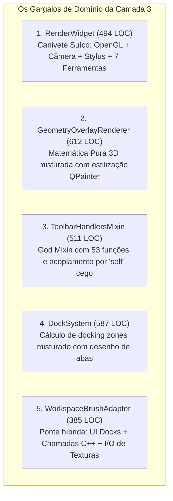

# 🏛️ DIAGNÓSTICO ARCcC v2: CAMADA 3 (WORKSPACE CORE & CANVAS)
## *Raio-X de Coesão, Acoplamento e Limites Arquiteturais do Workspace do Lumenia*

---

## 🧭 1. RESUMO EXECUTIVO & CENSO ESTRUTURAL

Enquanto a **Camada 1 (Motor C++ Nativo)** foi totalmente estabilizada e auditada (100% dos 110 arquivos $< 500\text{ LOC}$ e 143 testes verdes), a **Camada 3 (Workspace Core & Canvas)** representa hoje o **principal epicentro de atrito, acoplamento e inserção acidental de bugs** no projeto.

### Censo Quantitativo de Arquivos (`plugins/system/workspace_core`):
- **Total de Arquivos Analisados**: 46 arquivos Python.
- **Violações Mecânicas da Regra 4 ($\ge 500\text{ LOC}$)**: **4 arquivos** violando diretamente o teto.
- **Arquivos no Limite de Ruptura ($400 \text{ a } 499\text{ LOC}$)**: **4 arquivos** com alta densidade de código e alto risco.
- **Violações Qualitativas de Coesão (ARCcC v2 - Teste do "E")**: **8 módulos críticos** acumulando de 4 a 6 domínios técnicos distintos.

---

## 🚨 2. OS 4 ARQUIVOS EM VIOLAÇÃO DIRETA DE LOC ($\ge 500$)

| Arquivo | LOC | Funções | Importações | Domínios Misturados |
|---|:---:|:---:|:---:|---|
| **`geometry_overlay_renderer.py`** | **612** | 10 | 2 | Matemática 3D de Câmera + Perspectiva 1P/2P/3P + Curvilínea 6P + Réguas Polares + Simetria + Letterbox |
| **`dock_system.py`** | **587** | 38 | 14 | Layout de Painéis + Abas + Hit-Test de Drop Zones + Splitters de Redimensionamento + Persistência JSON |
| **`secondary_tool_bar/toolbar_handlers.py`** | **511** | 53 | 5 | *God Mixin* contendo 53 handlers de ferramentas desconexas (balde, texto, varinha, laço, formas, etc.) |
| **`geometry_tool_controller.py`** | **504** | 19 | 3 | Edição interativa de pontos de fuga + horizonte + âncoras de simetria + controles numéricos |

---

## 💥 3. O RAIO-X QUALITATIVO DE COESÃO (ARCcC v2)

Sob a ótica do **ARCcC v2 (Pureza de Domínio e Responsabilidade Única)**, identificamos 5 anomalias graves que explicam por que edições nesta camada frequentemente geram efeitos colaterais:

---

### Anomalia 1: `render_widget.py` (494 LOC, 31 Dependências, 53 Métodos)
- **Diagnóstico**: Está tecnicamente em 494 LOC após a extração da Viewport, mas permanece como o componente mais acoplado do frontend.
- **O que ele acumula**:
  1. *Ciclo de Vida do Hardware*: `QOpenGLWidget`, `QSurfaceFormat 3.3 Core`, swap intervals.
  2. *Câmera e Projeção*: Mapeamento afim de coordenadas de tela para canvas (`to_canvas`).
  3. *Captura e Roteamento de Entrada*: Mouse, stylus tablet (Wacom/Huion), pressão, tilt e touch.
  4. *Gestão Direta de 7 Ferramentas*: Instanciação e chaveamento de `selection_ctrl`, `shape_ctrl`, `transform_ctrl`, `eyedrop_ctrl`, `geometry_ctrl`, `text_ctrl`, `cursor_ctrl`.
  5. *Padrões de Apresentação*: Renderização do padrão xadrez (*checkerboard*) e papel de fundo.
  6. *Telemetria de Frame*: Medição de tempos de apresentação e FPS.
- **Impacto**: Qualquer desenvolvedor tentando aprimorar o cursor flutuante ou o laço de seleção acaba alterando o `render_widget.py`, correndo risco constante de quebrar o pipeline do OpenGL ou a rota de eventos da caneta.

---

### Anomalia 2: `geometry_overlay_renderer.py` (612 LOC — Violação da Regra Q3)
- **Diagnóstico**: Viola a **Regra Q3 (Isolamento por Causa de Mudança)** ao juntar matemática trigonométrica analítica com rotinas visuais do `QPainter`.
- **O que ele acumula**:
  - `rotate_3d_backward`: Rotação euclidiana 3D pura (Yaw, Pitch, Roll).
  - `create_curve_from_normal`: Projeção de círculos conformes para Fisheye de 6 Pontos.
  - Desenho de grades de perspectiva de 1, 2 e 3 Pontos de Fuga.
  - Desenho de grades isométricas e polares.
  - Eixos de simetria radial e caleidoscópio.
  - Enquadramento de cinema (*Letterbox / Aspect Ratio Safe Areas*).
- **Impacto**: Ajustar a cor ou espessura da linha de simetria exige editar o mesmo arquivo que calcula a matriz de projeção esférica 3D.

---

### Anomalia 3: `toolbar_handlers.py` (511 LOC — Anti-Padrão *God Mixin*)
- **Diagnóstico**: 53 funções amontoadas em um único mixin (`SecondaryToolbarHandlersMixin`).
- **O que ele acumula**:
  - Handlers de seleção por varinha mágica.
  - Handlers de texto e tipografia.
  - Handlers de simetria e réguas.
  - Handlers de preenchimento por balde.
  - Handlers de transformações livres.
- **Impacto**: Esse mixin assume cegamente que a instância `self` possui dezenas de atributos criados por outros mixins. Não há tipagem estrita nem contrato formal, gerando erros do tipo `AttributeError` em runtime sempre que um nome de propriedade muda.

---

### Anomalia 4: `dock_system.py` (587 LOC — Layout Híbrido)
- **Diagnóstico**: O sistema de docks gerencia o layout da janela, mas mistura a física geométrica de *drop zones* com a construção visual de botões de abas e a serialização de configurações.
- **O que ele acumula**:
  1. Criação de widgets de abas e botões de fechar.
  2. Algoritmo de cálculo de caixas delimitadoras (*bounding boxes*) para decidir se o dock deve ancorar à esquerda, direita ou virar aba (*hit-test*).
  3. Gerenciamento de splitters com redimensionamento dinâmico.
  4. Persistência em arquivo de estado do workspace.

---

### Anomalia 5: `workspace_brush_adapter.py` (385 LOC)
- **Diagnóstico**: Atua como uma ponte híbrida desestruturada entre a UI e a Camada 1.
- **O que ele acumula**:
  1. Conexão de sinais de painéis de UI (BrushDock).
  2. Chamadas diretas ao backend nativo (`backend.set_brush_color`, etc.).
  3. Abertura de diálogos do sistema operacional (`QFileDialog`) para carregar texturas de ponta de pincel e mapas de altura.
  4. Chaveamento de ferramentas ativas.

---

## 📐 4. MATRIZ DE RISCO E PRIORIZAÇÃO DE SANEAMENTO

| Subsistema / Módulo | LOC Atual | Risco Arquitetural | Ação Prioritária Necessária |
|---|:---:|:---:|---|
| **Módulo de Renderização Geométrica** (`geometry_overlay_renderer.py`) | **612 LOC** | 🔴 **CRÍTICO** | Decompor em `PerspectiveGridRenderer`, `SymmetryOverlayRenderer`, `RulerGridRenderer` e `Math3DProjector`. |
| **Sistema de Docks** (`dock_system.py`) | **587 LOC** | 🔴 **CRÍTICO** | Extrair `DockDropZoneCalculator` (hit-test) e `DockStatePersistence` (serialização). |
| **Handlers da Barra Secundária** (`toolbar_handlers.py`) | **511 LOC** | 🔴 **CRÍTICO** | Decompor em handlers específicos por domínio (`SelectionHandlers`, `TextHandlers`, `ShapeHandlers`). |
| **Controlador de Ferramenta Geométrica** (`geometry_tool_controller.py`) | **504 LOC** | 🔴 **CRÍTICO** | Separar edição de pontos de fuga da manipulação de réguas lineares e polares. |
| **Núcleo de Visualização** (`render_widget.py`) | **494 LOC** | 🔴 **CRÍTICO** | Extrair `ToolManager` (desacoplar as 7 ferramentas) e `CanvasGestureController`. |
| **Adaptador de Pincel do Workspace** (`workspace_brush_adapter.py`) | **385 LOC** | 🟡 **MÉDIO** | Isolar I/O de texturas de disco e conexões de sinais de dock. |

---

## 🏆 5. DIRETRIZES PARA O PLANO MESTRE DA CAMADA 3

Para elevar a Camada 3 ao mesmo nível de excelência e estabilidade da Camada 1, o plano de refatoração deve seguir:

1. **Eliminação do "God Mixin"**: Substituir herança múltipla frágil por **Composição Estrita** e injeção de dependências.
2. **Isolamento de Ferramentas via `ToolManager`**: O `RenderWidget` não deve conhecer os detalhes das 7 ferramentas; ele deve apenas despachar eventos para uma interface padronizada `IToolController`.
3. **Desacoplamento de Matemática e QPainter**: Isolar as fórmulas analíticas de projeção 3D e geometria em módulos puros e testáveis sem carregar widgets Qt.
4. **Respeito Absoluto aos Limites ARCcC v2**:
   - Teto rígido de **< 500 LOC** para todos os 46 arquivos da camada.
   - **1 Único Domínio Técnico por arquivo** (aprovação estrita no Teste do "E").
   - **Zero Regressão**: 143/143 testes devem permanecer verdes ao final de cada fase.
