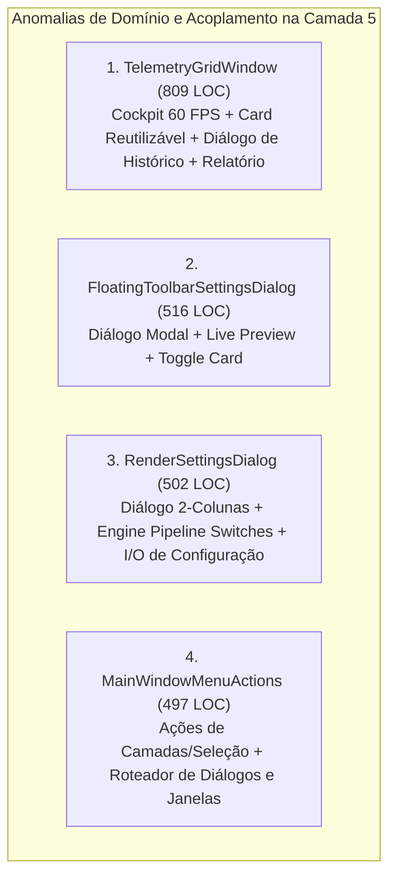

# 🏛️ DIAGNÓSTICO ARCcC v2: CAMADA 5 (SHELL, NÚCLEO UI & DIÁLOGOS)
## *Raio-X de Coesão, Acoplamento e Limites Arquiteturais do Núcleo de Interface do Lumenia*

---

## 🧭 1. RESUMO EXECUTIVO & CENSO ESTRUTURAL

Após a conclusão e homologação bem-sucedida das Camadas 1, 2, 3 e 4 (todas com 100% dos arquivos $< 500\text{ LOC}$ e zero regressões), a **Camada 5 (Shell, Núcleo UI & Diálogos)** representa a camada de maior superfície de contato do usuário com a aplicação.

Ela abriga os diálogos modais e não-modais do sistema, os orquestradores de menu da janela principal, telas de configuração, sistema de ícones, temas visuais, internacionalização e medidores de telemetria de alta frequência (60 FPS).

### Censo Quantitativo de Arquivos (`ui/`):
- **Total de Arquivos Analisados**: 137 arquivos Python.
- **Volume Total de Código**: 20.068 linhas de código (LOC).
- **Média por Arquivo**: 146,5 LOC (excelente granularidade média).
- **Violações Mecânicas do Teto ($\ge 500\text{ LOC}$)**: **3 arquivos** (2,19% do total).
- **Zona de Alerta Vermelha ($450 \text{ a } 499\text{ LOC}$)**: **4 arquivos** (2,92% do total).
- **Zona Amarela de Atenção ($300 \text{ a } 449\text{ LOC}$)**: **15 arquivos** (10,95% do total).
- **Zona Verde Segura ($< 300\text{ LOC}$)**: **115 arquivos** (83,94% do total).

---

## 🚨 2. OS 3 ARQUIVOS EM VIOLAÇÃO DIRETA DE LOC ($\ge 500$)

| Arquivo | LOC | Componentes Internos | Domínios Misturados |
|---|:---:|---|---|
| **`ui/core/dialogs/telemetry_grid_window.py`** | **809** | `GridMetricCard` (128 LOC) `TelemetryGridWindow` (681 LOC) Relatório e Histórico (166 LOC) | Card visual reutilizável + Cockpit de 20 medidores em tempo real + Timer 60 FPS + Histórico de transições de gargalos + Formatação textual de relatório de telemetria |
| **`ui/core/screens/floating_toolbar_settings_dialog.py`** | **516** | `ToolbarLivePreview` (61 LOC) `ToolToggleCard` (119 LOC) `FloatingToolbarSettingsDialog` (336 LOC) | Preview dinâmico de botões + Card de chaveamento individual de ferramentas + Diálogo modal com busca, ordenação e persistência |
| **`ui/core/dialogs/render_settings_dialog.py`** | **502** | `load/save_render_settings` (20 LOC) `EnginePipelineGroup` (55 LOC) `RenderSettingsDialog` (427 LOC) | Configurações do motor (baixa latência, gama linear, deep color, undo RAM) + Diálogo de perfis de cor ICC/LUT + Barra de pré-visualização espectral |

---

## ⚠️ 3. ARQUIVOS NA ZONA DE ALERTA VERMELHA ($450 - 499\text{ LOC}$)

| Arquivo | LOC | Risco e Diagnóstico |
|---|:---:|---|
| **`ui/boundary/orchestrator/main_window_menu_actions.py`** | **497** | **Risco Crítico Imediato (3 LOC do teto de 500).** Mistura manipulação de documentos, camadas e seleção com abertura e instanciação de dezenas de diálogos e telas de configuração do sistema operacional. |
| **`ui/core/icons.py`** | **486** | Catálogo puro de paths SVG vetorizados. Embora extenso, possui baixíssima complexidade ciclomática (dicionário de strings). Manter sob monitoramento sem fatiamento artificial. |
| **`ui/core/dialogs/telemetry_diagnostics_dialog.py`** | **474** | Diálogo complementar de diagnóstico de motor e hardware. Está estável, mas requer vigilância. |
| **`ui/core/screens/settings/theme_dialog.py`** | **458** | Editor de temas visuais e paletas de cores. Possui separação interna razoável, monitorar para evitar expansão futura. |

---

## 💥 4. O RAIO-X QUALITATIVO DE COESÃO (ARCcC v2 - TESTE DO "E")

### Anomalia 1: `telemetry_grid_window.py` (809 LOC)
- **Diagnóstico**: O cockpit F12 foi concebido para monitoramento em tempo real a 60 FPS do motor nativo C++, mas incorporou múltiplas responsabilidades subsidiárias:
  1. **Widget de Card Métrico (`GridMetricCard`)**: Componente genérico que possui estilização com CSS dinâmico, dot de status, barras de progresso configuráveis e labels tipadas. Esse widget tem valor para outros monitores da aplicação e não deve viver confinado dentro de um único diálogo.
  2. **Histórico de Transições e Diagnóstico**: Diálogo modal interno para inspecionar histórico de gargalos (`_show_state_history_dialog`).
  3. **Gerador de Relatórios Textuais (`generate_full_report`)**: Rotina de formatação de 120 linhas que extrai dados do backend, calcula porcentagens, formata strings de milissegundos/microssegundos e gera o relatório para a Área de Transferência.
- **Impacto**: Qualquer ajuste visual em um card ou na formatação de relatório exige editar um arquivo monolítico de mais de 800 linhas com lógica de temporização precisa de 60 FPS.

### Anomalia 2: `floating_toolbar_settings_dialog.py` (516 LOC)
- **Diagnóstico**: O diálogo de personalização da barra de ferramentas flutuante contém dois componentes visuais inline que violam o isolamento por pasta do ARCcC:
  1. `ToolbarLivePreview`: Um widget de moldura que renderiza botões dinâmicos em escala reduzida refletindo as escolhas ativas em tempo real.
  2. `ToolToggleCard`: Um card com ícone, título, checkbox estilizado e interação tátil para ativar/desativar ferramentas individuais.
- **Impacto**: O diálogo principal assume a responsabilidade de instanciar, estilizar e manipular eventos de baixo nível de cada cartão de ferramenta, ultrapassando os 500 LOC.

### Anomalia 3: `render_settings_dialog.py` (502 LOC)
- **Diagnóstico**: O diálogo principal já consome componentes de `render_settings_components.py` (`ProofingPreviewBar` e `ProfileCard`), mas ainda retém internamente:
  1. Funções de persistência e I/O (`load_render_settings`, `save_render_settings`).
  2. O bloco completo de controles do motor físico (`EnginePipelineGroup`), que ocupa quase 60 linhas montando switches de baixa latência, gama linear, deep color e memória de undo.
- **Impacto**: O diálogo ultrapassa levemente o teto (502 LOC), enquanto seu arquivo complementar de componentes (`render_settings_components.py`) tem apenas 165 LOC e capacidade ociosa.

### Anomalia 4: `main_window_menu_actions.py` (497 LOC)
- **Diagnóstico**: O mixin de ações de menu da janela principal acumula dois eixos funcionais completamente ortogonais:
  1. **Eixo 1 — Edição e Operação de Conteúdo**: Recortar, copiar, colar, preencher, selecionar tudo, inverter seleção, duplicar camada, mesclar, visibilidade, bloqueio alfa, redimensionar canvas, girar 90/180°, espelhar horizontal/vertical.
  2. **Eixo 2 — Roteamento e Instanciação de Diálogos**: Abertura de preferências de atalhos, configurações de cursor, envio de feedback, sobre a aplicação, relatório de testes, guia do usuário, diagnósticos e cockpit de telemetria.
- **Impacto**: Estando a meras 3 linhas do limite de 500 LOC (497 LOC), qualquer novo item de menu inserido no futuro quebrará o teto de código.

---

## 🎯 5. METAS ESTRUTURAIS DE ELEVAÇÃO DA CAMADA 5

1. **Eliminar 100% das violações $\ge 500\text{ LOC}$**: Reduzir os 3 arquivos críticos para a faixa de $300 - 380\text{ LOC}$.
2. **Descomprimir a Zona Vermelha**: Desacoplar `main_window_menu_actions.py` (497 LOC) em dois mixins coesos (`main_window_menu_actions.py` e `main_window_dialog_actions.py`), reduzindo-o para $\approx 350\text{ LOC}$.
3. **Isolamento de Componentes Reutilizáveis**: Criar `ui/core/widgets/metric_card.py` e `ui/core/screens/floating_toolbar_components.py`, promovendo reuso em toda a suíte.
4. **Preservação de 100% dos Contratos**: Manter compatibilidade total de APIs, nomes de classes, sinais Qt e assinaturas de métodos.
5. **Zero Regressões**: Garantir que a suíte completa de testes automatizados continue 100% verde.
