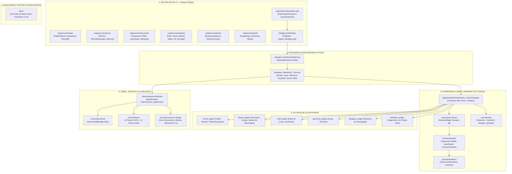

# 🏛️ Lumenia Art Studio & Aladyn Engine — Mapeamento Estrutural e Arquitetura de Módulos
**Documento de Consulta Atemporal da Base de Código**

---

## 1. Visão Geral da Arquitetura (Padrão ARCcC)

O **Lumenia** adota o padrão arquitetural **ARCcC** (*Aladyn Reactive Canvas Core*), que estabelece uma separação rígida entre a interface do usuário reativa e o núcleo de renderização nativo:

---

## 2. Camada 1: Motor Nativo C++ (`engine/` e `bridge/`)

Compilado em módulo binário C++17 com extensões SIMD (`/arch:AVX2`, `/openmp`, `/O2`) gerando `aladyn_engine_native.pyd`.

### A. Fronteira Externa (`engine/boundary/public-api/`)
* **`PaintEngineFacade.hpp / .cpp`**: Fachada pública central do motor. Encapsula todo o ciclo de vida do canvas, traçado, camadas, desfazer/refazer, filtros e telemetria.
* **`internal/` (Orquestradores de Subsistemas)**:
  * `StrokeOrchestrator.hpp / .cpp`: Conexão entre cinemática, carimbos, histórico de tiles e composição durante o traço.
  * `SelectionOrchestrator.hpp / .cpp`: Operações booleanas e confinamento de rasterização a máscaras ativas.
  * `TransformOrchestrator.hpp / .cpp`: Amostragem afim e interpolação de caixas de seleção e camadas.
  * `BufferPasteOrchestrator.hpp / .cpp`: Injeção e mesclagem de buffers externos de imagem.
  * `LayerStackOrchestrator.hpp`: Manipulação de hierarquia da pilha de camadas.

### B. Rasterização e Processamento de Pixels (`engine/core/raster/`)
* `DabRenderer.hpp / .cpp`: Rasterizador ultra-otimizado com ponteiros de memória direta em 32 bits, culling circular scanline e shading analítico pré-calculado.
* `DabInterpolator.hpp / .cpp`: Amostragem de distância entre coordenadas de ponteiro com modulação adaptativa de passo e clamp proporcional.
* `FloodFill.hpp / .cpp`: Balde de tinta nativo com algoritmo de crescimento por expansão e fechamento de gaps (*gap-closing*).
* `SelectionEngine.hpp / .cpp` & `SelectionMask.hpp`: Estrutura de seleção em escala de cinza de 8 bits (1 byte/pixel) e detecção de bordas.
* `TransformEngine.hpp / .cpp` & `transform/TransformSamplers.hpp`: Filtros de interpolação analítica (Nearest Neighbor, Bilinear Suave e Bicúbico).
* `PixelContext.hpp`, `Dab.hpp`.

### E. Cor e prova de gamut (`engine/core/color/`)
* `ColorProfile.hpp / .cpp`: Fonte única dos IDs, metadados e transformações
  usadas pela fachada, pela ponte e pela prévia da interface.

### C. Gerenciamento de Memória do Canvas (`engine/core/canvas/`)
* `TileGrid.hpp / .cpp`: Grade esparsa de blocos de memória (*tiles*) de 128×128 pixels. Aloca apenas as regiões tocadas pelo pincel.
* `TileUndoManager.hpp / .cpp`: Gerenciador de histórico de desfazer/refazer com verificação prévia sem alocação (`std::memcmp`) e limpeza linear $O(N)$.
* `SpatialCuller.hpp / .cpp`: Culling de blocos fora da área de visão ou fora da região alterada (*dirty rect*).
* `Tile.hpp`, `PixelBuffer.hpp`, `CanvasTexture.hpp`.

### D. Árvore de Camadas e Composição (`engine/core/document/`)
* `Compositor.hpp / .cpp`: Compositor multi-camada acelerado por SIMD, recombinando camadas ativas na textura final da tela.
* `LayerStack.hpp / .cpp`: Árvore hierárquica de nós de documento.
* `Layer.hpp`, `LayerGroup.hpp`, `LayerNode.hpp`: Modelos de nós de pintura normal, grupos aninhados e propriedades de camada.
* `FilterLayer.hpp / .cpp`: Camadas de ajuste procedural não-destrutivas.
* **`blending/`**:
  * `BlendEquations.hpp`: Implementação matemática dos 27 modos de mesclagem (Normal, Multiplicar, Tela, Sobrepor, Luz Direta, etc.).
  * `FilterApplier.hpp / .cpp`: Processamento analítico de curvas tonais, brilho/contraste e desfoques.

### E. Mini-Motores de Pincel Especializados (`engine/core/engines/`)
* `IBrushEngine.hpp`: Interface base para motores de renderização.
* `InkerEngine.hpp / .cpp`: Tinta lisa e caneta caligráfica precisa.
* `PencilEngine.hpp / .cpp`: Lápis com simulação de grão e atrito de grafite.
* `MarkerEngine.hpp / .cpp`: Marcador com acúmulo de pigmento semi-transparente.
* `WatercolorEngine.hpp / .cpp`: Aquarela com difusão úmida e bordas de pigmento (*fringing*).
* `OilImpastoEngine.hpp / .cpp`: Pintura a óleo com relevo tridimensional de cerdas (*impasto*).
* `SmudgeEngine.hpp / .cpp`: Esfumador e misturador físico de tinta úmida.
* `EraserEngine.hpp / .cpp`: Borracha analítica com preservação de alfa.
* `BlurEngine.hpp / .cpp`: Desfoque gaussiano local e suavizador de transições.

### F. Cinemática, Estabilização e Física do Traço (`engine/core/stroke/`)
* `DynamicStabilizer.hpp / .cpp`: Estabilizador dinâmico de traço com puxada proporcional, flush atômico e projeção de afunilamento (*taper*).
* `VelocityTracker.hpp / .cpp`: Rastreamento de velocidade instantânea e aceleração da ponta.
* `PointerEvent.hpp`: Encapsulamento de coordenadas, pressão, inclinação e timestamp.

### G. Matemática Vetorial e Snapping (`engine/core/math/`)
* `GuideSnapEngine.hpp / .cpp`: Atração magnética por réguas, guias e grades ortogonais/isométricas.
* `SymmetryEngine.hpp / .cpp`: Espelhamento radial (até 16 eixos), horizontal e vertical com snapping.
* `BezierCurve.hpp / .cpp`: Interpolação de curvas suaves e splines de traço.
* `MathUtils.hpp`, `Point2D.hpp`, `Rect2D.hpp`, `Vector2D.hpp`.

### H. Texturas e Espaços de Cor (`engine/core/texture/`, `color/`, `telemetry/`)
* `Texture2D.hpp / .cpp` & `ProceduralTextures.hpp / .cpp`: Geração de ruídos perlin e mapas de relevo de papel.
* `ColorProfile.hpp / .cpp`: Transformação matricial entre sRGB, Display P3 e Adobe RGB.
* `EngineTelemetry.hpp`: Estrutura de telemetria de alta resolução em nanossegundos.

### I. Ponte de Ligação PyBind11 (`bridge/core/bindings/`)
* `engine_bindings.cpp`: Mapeia classes, métodos, enums e buffers de memória C++ diretamente para o interpretador Python.

---

## 3. Camada 2: Backend de Integração & Mixins (`ui/engine_backends/`)

* **`aladyn.py`**: Classe `AladynBackend` implementando `IEngineBackend`. Centraliza a comunicação com o motor C++ sem permitir vazamento de ponteiros crus para a UI.
* **Mixins Especializados**:
  * `aladyn_stroke_mixin.py`: Ciclo de vida do traçado (`begin_stroke_raw`, `update_stroke_raw`, `end_stroke_raw`).
  * `aladyn_layer_mixin.py`: Comandos de gerenciamento da árvore de camadas e grupos.
  * `aladyn_selection_mixin.py`: Operações de seleção e máscara.
  * `aladyn_transform_mixin.py`: Operações de transformação geométrica de camadas e seleções.
  * `aladyn_brush_mixin.py`: Parametrização de perfis de ponta, dinâmicas de pressão e texturas.
  * `aladyn_geometry_mixin.py`: Configuração de simetria e réguas magnéticas no motor nativo.
  * `aladyn_mdi_mixin.py`: Isolamento MDI entre abas de documentos.
  * `aladyn_color_mixin.py`: Conversão e amostragem de cores.
  * `wgpu_rust.py`: Interface para futuro backend gráfico via WebGPU.

---

## 4. Camada 3: Workspace Core & Viewport do Canvas (`plugins/system/workspace_core/workspace/`)

* **Orquestração Geral**:
  * `workspace_container.py`: Container MDI principal que acolhe o canvas, barras flutuantes e painéis.
  * `workspace_layout_manager.py`: Posicionamento e dimensionamento responsivo das áreas de trabalho.
  * `workspace_brush_adapter.py`: Conexão entre eventos de painéis de pincel e o canvas.
  * `workspace_document_sync.py`: Sincronização entre abas de documentos abertos e o backend ativo.
  * `dock_system.py`: Sistema de painéis laterais retráteis (*drawers*) com animações suaves.
  * `floating_toolbar.py`: Barra flutuante principal com ferramentas de pintura e seleção.
  * `secondary_tool_bar.py`: Barra secundária dinâmica com opções contextuais da ferramenta selecionada.
  * `viewport_container.py`, `canvas_overlay.py`, `pill_handle.py`.

* **`canvas/` (A Viewport do Canvas)**:
  * `render_widget.py`: Widget gráfico central (`CanvasWidget`). Executa o Blit da textura do documento, gerencia `paintEvent`, repinturas cirúrgicas e eventos da mesa digitalizadora.
  * `text_overlay_editor.py`: Caixa de edição de texto vetorial na tela.
  * **`viewport/`**:
    * `camera_controller.py`: Controle de zoom focal ancorado, translação (*pan*) e rotação livre.
    * `cursor_controller.py`: Ciclo de vida do cursor flutuante e do anel geométrico com cache de matrizes e regiões `QRegion`.
    * `input_router.py`: Roteamento atômico de eventos de mouse, caneta digitalizadora (*tablet*) e gestos multitouch.
    * `canvas_compat.py`: Camada de normalização de eventos.
  * **`renderers/`**:
    * `tool_cursor_renderer.py`: Renderização de anéis de alto contraste com cache de `QPen` e cursores SVG nativos.
    * `overlay_renderer.py`: Linhas de seleção pontilhadas (*marching ants*), caixa de transformação e lupa de cor.
    * `geometry_overlay_renderer.py`: Visualização gráfica de eixos de simetria e réguas de perspectiva.
  * **`tools/` (Controladores de Ferramentas Ativas)**:
    * `selection_tool_controller.py`: Seleção retangular, elíptica e lasso à mão livre/poligonal.
    * `transform_tool_controller.py`: Manipulação interativa de pivô, escala e rotação com 8 alças.
    * `shape_tool_controller.py`: Desenho em tempo real de formas geométricas.
    * `eyedrop_tool_controller.py`: Conta-gotas com lupa de amostragem.
    * `geometry_tool_controller.py`: Manipulação interativa de réguas e eixos de simetria.
    * `text_tool_controller.py`: Manipulação de instâncias de texto.

* **`secondary_tool_bar/tool_options/`**:
  * Opções de Ferramentas: `bucket_options.py`, `wand_options.py`, `lasso_options.py`, `shapes_options.py`, `smudge_options.py`, `text_options.py`, `transform_options.py`, `geom_options.py`, `eyedrop_options.py`.

---

## 5. Camada 4: Plugins de Interface de Usuário (`plugins/ui/`)

* **`brush_plugin/`**:
  * `panel.py`: Painel de controle rápido de tamanho, opacidade, fluxo e cor.
  * `brush_dropdown.py`: Seletor pop-up de categorias e presets com renderização de miniaturas.
  * `presets_data.py`: Catálogo de pincéis padrão do estúdio.
  * `stroke_preview.py`: Visualizador de traço dinâmico em tempo real.
  * `advanced_panel/`: Diálogo de configuração detalhada de pontas dividido em 4 módulos:
    * `size_opacity_section.py`: Curvas de sensibilidade à pressão e velocidade.
    * `tip_geometry_section.py`: Ângulo, formato elíptico e rotação guiada pelo traço.
    * `jitters_section.py`: Variações estocásticas de tamanho, ângulo e posição.
    * `brush_texture_section.py`: Texturas de ponta e granulação de tela.

* **`layers_plugin/`**:
  * `panel.py`: Painel acoplável com a pilha de camadas.
  * `model.py` & `view.py`: Modelo hierárquico Qt (`QAbstractItemModel` / `QTreeView`) com suporte a subgrupos recursivos.
  * `delegate.py`: Renderização personalizada de itens da lista de camadas (miniaturas, visibilidade, Alpha Lock, Clipping Mask).
  * `grid.py`: Grade de pré-visualização de camadas.
  * `paper.py`: Gestão da camada especial de fundo do papel.
  * `panel_actions.py`, `panel_sync.py`, `panel_filter_dialogs.py`, `panel_rename_popup.py`.

* **`color_plugin/`**:
  * `panel.py` & `color_wheel.py`: Roda de cores cromática HSV/RGB com histórico de paletas recentes e harmonias cromáticas.

* **`geometry_plugin/`**:
  * `panel.py`: Painel de simetria e réguas magnéticas.
  * `components/advanced_settings_dialog.py`: Configurações de guias curvilíneas e perspectiva isométrica.

* **`navigator_plugin/`**:
  * `panel.py` & `components/navigator_preview.py`: Miniatura global do canvas com moldura interativa de controle da câmera.

* **`telemetry_plugin/`**:
  * `panel.py`: Painel de métricas do motor (taxa de FPS da viewport, latência por dab, blocos gravados).

---

## 6. Camada 5: Shell, Núcleo UI & Diálogos (`ui/`)

* **`ui/boundary/orchestrator/` (Shell do Aplicativo)**:
  * `main_window.py`: Janela principal que orquestra layouts, menus, dock lateral e workspace.
  * `main_window_menu_builder.py`: Construtor declarativo de todos os menus de topo.
  * `main_window_menu_actions.py`: Implementação dos callbacks de ação do menu.
  * `app_runner.py`: Inicialização do aplicativo Qt com flags de alto DPI e configuração de estilo.

* **`ui/core/components/menu_bar/` (Menus de Topo)**:
  * `menu_bar.py`: Container da barra superior.
  * Submenus especializados: `file_menu.py`, `edit_menu.py`, `select_menu.py`, `layer_menu.py`, `image_menu.py`, `filter_menu.py`, `view_menu.py`, `theme_menu.py`, `plugins_menu.py`, `help_menu.py`.

* **`ui/core/document/` (Gestão MDI de Documentos)**:
  * `manager.py`: Singleton `DocumentManager` gerenciando abas e documentos abertos.
  * `document.py`: Modelo lógico de dados do documento.
  * `layer_manager.py`: Gerenciamento de camadas no nível Python.

* **`ui/core/engine/` (Infraestrutura do Motor)**:
  * `registry.py`: Singleton `EngineRegistry` para injeção de dependência do backend ativo.
  * `backend.py`: Contrato abstrato `EngineBackend`, incluindo capacidades
    efetivas, controles de pipeline e exportação canônica.
  * `telemetry_tracker.py`: Rastreador de telemetria com classificação de gargalos do pipeline.
  * `flood_fill.py`, `commands.py`, `errors.py`.

* **`ui/core/theme/` (Sistema Visual Dinâmico)**:
  * `manager.py`: Singleton `ThemeManager` com alternância a quente de temas sem reiniciar.
  * `themes/`: 9 temas JSON (`dark_default`, `lumenia_purple`, `oled_black`, `cyberpunk`, `nordic_frost`, `warm_ochre`, `paper_white`, `light_default`, `lumenia_light`).
  * `themes/qss_modules/`: 10 folhas de estilo QSS modulares compiladas com substituição de tokens.

* **`ui/core/i18n/` (Internacionalização)**:
  * `manager.py`: Singleton `I18nManager` e função global `tr()`.
  * `assets/locales/`: Dicionários de tradução em JSON (`pt_BR`, `en_US`, `es_ES`, `ja_JP`).

* **`ui/core/screens/` e `ui/core/dialogs/` (Telas e Diálogos Especializados)**:
  * `new_document_dialog.py` (+ `new_document/preset_catalog.py`): Criação de documentos com presets categorizados (Ilustração, Quadrinhos, Web, Print).
  * `cursor_settings_dialog.py`: Preferências de cursores (Anel + Dot, Apenas Anel, Apenas Ponto, Crosshair, Sistema).
  * `telemetry_grid_window.py`: Cockpit flutuante de diagnóstico em tempo real (F12).
  * `keyboard_shortcuts_dialog.py`: Diálogo interativo de remapeamento de atalhos de teclado.
  * `render_settings_dialog.py`: Configurações de limite de memória de desfazer e precisão de cor.
  * `canvas_size_dialog.py`, `layer_properties_dialog.py`, `modify_selection_dialog.py`, `curve_window.py`, `about_dialog.py`, `test_report_dialog.py`, `user_guide_dialog.py`.
  * `filters/`: Diálogos de ajuste de filtros de camada (Brilho/Contraste, Matiz/Saturação, Curvas, Desfoque).

* **`ui/core/widgets/` (Biblioteca de Componentes Visuais Reutilizáveis)**:
  * `compact_slider.py`, `labeled_slider.py`, `step_button.py`: Sliders compactos com arraste de precisão.
  * `color_picker/`: `picker.py`, `color_wheel.py`, `color_swatch_widgets.py`.
  * `pipeline_bar.py`: Barra de status visual do pipeline de renderização.
  * `shape_dropdown.py`, `card_box.py`, `toggle_switch.py`, `collapsible_section.py`.

---

## 7. Camada 6: Suíte de Testes Automatizados (`tests/`)

Composta por 41 suítes sob governança estrita ARCcC v2 (< 500 LOC, alvo < 300 LOC) que validam o comportamento estrutural e numérico do sistema:

1. **Invariantes Arquiteturais & Governança de Código**:
   * `test_arccc_architecture_invariants.py`: Garante que nenhum arquivo de UI ou plugins acesse atributos privados do motor nativo, quebre os limites de camada ou viole o teto estrito de 500 LOC em plugins, ui e tests.
2. **Motor C++ de Baixo Nível & Estresse Numérico**:
   * `test_lowlevel_brush_raster.py`: Valida precisão de pixel, raio dinâmico e resposta a curvas de pressão.
   * `test_lowlevel_undo_tile_stress.py`: Estresse de blocos, consumo de RAM, integridade de desfazer/refazer.
   * `test_lowlevel_telemetry_diagnostics.py`: Validação de temporizadores em nanossegundos e detecção de sobrecarga.
   * `test_lowlevel_blend_modes.py`: Teste numérico dos 27 modos de mesclagem.
   * `test_lowlevel_color_profiles.py`: Conversão matemática entre espaços de cor.
   * `test_lowlevel_selection_transform.py`: Amostragem afim e operações booleanas de seleção.
   * `test_lowlevel_phase3_giant_brushes_simd.py`, `test_lowlevel_phase4_memory_scalability.py`.
3. **Pilha de Camadas, Grupos & Decomposição Estrutural**:
   * `test_phase1_layers.py`: Criação, remoção, duplicação, Alpha Lock e Clipping Mask.
   * `test_phase2_groups.py`: Grupos, hierarquia aninhada, modo Pass-Through e visibilidade/opacidade recursivas.
   * `test_geometry_decomposition_phase1.py`, `test_advanced_geometry_dialog_phase3.py`.
4. **Ciclo de Vida MDI & Memória**:
   * `test_mdi_multidoc_lifecycle.py`: Isolamento de instâncias de documento e liberação de memória em abas.
5. **Interface, Telas, Menus & Internacionalização**:
   * `test_menu_bar_complete_wiring.py`: Acionamento dos 10 submenus e vinculação com atalhos.
   * `test_new_document_dialog.py`: Validação de presets e parâmetros de criação de documento.
   * `test_theme_system.py`: Compilação de temas e reatividade QSS.
   * `test_i18n_system.py` & `test_i18n_localization.py`: Tradução dinâmica em tempo de execução.
   * `test_dialogs_i18n.py`: Re-tradução de todos os diálogos de preferências de sistema (Docks, Toolbar Flutuante, Tema, Render, Cursores, Atalhos, Telemetria e Janelas MDI).
   * `test_toolbars_geometry_i18n.py`: Re-tradução de opções contextuais da barra secundária, botões de forma/transformação e painel/diálogo de geometria assistida.
   * `test_dialogs_theme_and_docs.py`, `test_config_manager.py`, `test_geometry_symmetry.py`, `test_5_observations_audit.py`, `test_audit_8_items.py`.

---

## 8. Estatísticas e Resumo Numérico da Base de Código (6 Camadas ARCcC)

| Grande Área / Camada | Número de Módulos / Arquivos | Linhas de Código (LOC) | Conformidade ARCcC v2 (< 500 LOC) |
| :--- | :---: | :---: | :---: |
| **Camada 1: Motor Nativo C++ (`engine/` + `bridge/`)** | 68 arquivos | ~11.800 LOC | 🟢 100% em Conformidade (Ponte Modular) |
| **Camada 2: Backend & Adaptadores (`ui/engine_backends/`)** | 12 arquivos | ~2.900 LOC | 🟢 100% em Conformidade (Universal Backend) |
| **Camada 3: Workspace Core & Viewport (`plugins/system/`)** | 55 arquivos | ~7.200 LOC | 🟢 100% em Conformidade (Desacoplamento MDI) |
| **Camada 4: Plugins de UI Especializados (`plugins/ui/`)** | 38 arquivos | ~5.800 LOC | 🟢 100% em Conformidade (Isolamento Caixa-Preta) |
| **Camada 5: Shell, UI Core & Diálogos (`ui/core/` + `ui/boundary/`)** | 141 arquivos | ~20.134 LOC | 🟢 100% em Conformidade (Zero Violações) |
| **Camada 6: Suíte de Testes Automatizados (`tests/`)** | 41 arquivos | ~5.552 LOC | 🟢 100% em Conformidade (Zero Violações) |
| **Assets do Sistema (Ícones SVG, Dicionários i18n, Temas QSS)** | 160+ arquivos | — | 🟢 Recursos Dinâmicos |
| **TOTAL GLOBAL DO PROJETO** | **~355 módulos** | **~53.386 LOC** | 🟢 **100% EM CONFORMIDADE (ZERO VIOLAÇÕES)** |
