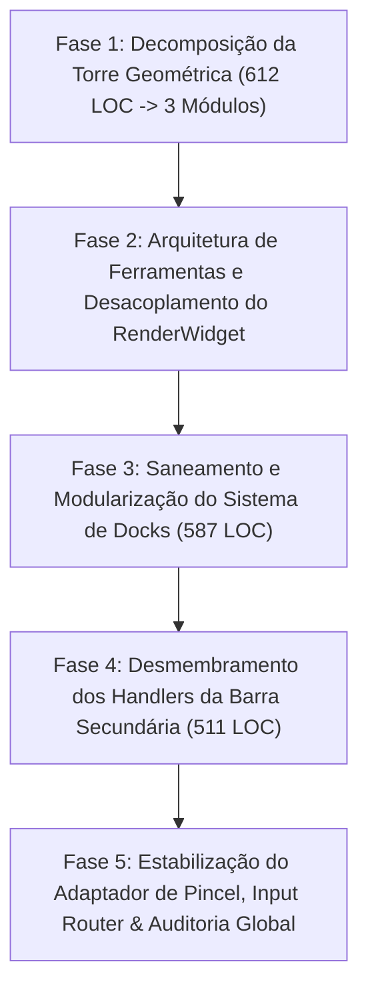

# 🏛️ PLANO MESTRE DE ELEVAÇÃO: CAMADA 3 (WORKSPACE CORE & CANVAS)
## *Engenharia de Desacoplamento, Pureza de Domínio e Eliminação de God Classes/Mixins sob o Padrão ARCcC v2*

---

## 🧭 1. VISÃO E OBJETIVOS ESTRATÉGICOS

Este Plano Mestre estabelece a rota de engenharia para sanear integralmente a **Camada 3 (Workspace Core & Canvas)** do Lumenia, aplicando os princípios do **ARCcC v2 (Pureza de Domínio e Responsabilidade Única)** estabelecidos no nosso framework.

### Metas Globais Inegociáveis:
1. **Zero Violações Quantitativas de LOC**: Sanar os 4 arquivos que hoje ultrapassam 500 linhas (`geometry_overlay_renderer.py`, `dock_system.py`, `toolbar_handlers.py`, `geometry_tool_controller.py`), trazendo todos para a faixa segura de $150 \text{ a } 350\text{ LOC}$.
2. **Desacoplamento do `RenderWidget` (494 LOC)**: Reduzir a complexidade ciclomática e de dependências (31 imports) através da introdução do `ToolManager`, delegando o controle das 7 ferramentas para uma interface limpa.
3. **Eliminação dos "God Mixins"**: Substituir mixins com acesso cego a `self` por Composição Estrita e injeção de dependências tipadas.
4. **Isolamento de Matemática Pura**: Desacoplar cálculos trigonométricos 3D e projeção analítica de classes que invocam `QPainter`.
5. **Zero Regressão**: 100% dos 143 testes automatizados devem permanecer verdes em todas as fases.

---

## 🗺️ 2. CRONOGRAMA DAS 5 FASES DE ELEVAÇÃO

---

## 📋 3. DETALHAMENTO DAS FASES

---

### 📐 FASE 1: DECOMPOSIÇÃO DA TORRE GEOMÉTRICA (OVERLAYS & CONTROLLERS)
*Foco: Eliminar as maiores violações ativas da Regra 4 e separar matemática pura de desenho Qt.*

- **Arquivos-Alvo**:
  - `geometry_overlay_renderer.py` (**612 LOC**) $\rightarrow$ Decompor em submódulos especializados $< 250\text{ LOC}$.
  - `geometry_tool_controller.py` (**504 LOC**) $\rightarrow$ Separar edição de perspectiva de réguas lineares e polares.
- **Entregas Técnicas**:
  1. `math/camera_3d_projector.py`: Funções matemáticas puras (`rotate_3d_backward`, `create_curve_from_normal`) sem dependência de `QPainter` ou widgets de tela.
  2. `renderers/perspective_grid_renderer.py`: Renderização exclusiva de grades de perspectiva (1P, 2P, 3P, Curvilínea 6P / Fisheye) e horizonte.
  3. `renderers/symmetry_overlay_renderer.py`: Renderização exclusiva de eixos de simetria (Bilateral, Radial, Caleidoscópio).
  4. `renderers/ruler_grid_renderer.py`: Renderização exclusiva de réguas isométricas, polares, paralelas e enquadramento letterbox.
  5. Decomposição de `geometry_tool_controller.py` em handlers focados (`PerspectiveToolHandler`, `RulerToolHandler`).
- **Critério de Aceite**: Nenhum arquivo do subsistema geométrico $\ge 300\text{ LOC}$.

---

### 🎨 FASE 2: ARQUITETURA DE FERRAMENTAS & DESACOPLAMENTO DO RENDERWIDGET
*Foco: Transformar o `render_widget.py` de um "Canivete Suíço de 494 LOC" em um canvas limpo e focado.*

- **Arquivo-Alvo**: `render_widget.py` (**494 LOC**, 31 imports, 53 métodos).
- **Entregas Técnicas**:
  1. Criar `canvas/tools/tool_manager.py`:
     - Gerenciador central do ciclo de vida das 7 ferramentas ativas (`selection`, `shape`, `transform`, `eyedrop`, `geometry`, `text`, `cursor`).
     - Despacho polimórfico de eventos (`on_press`, `on_drag`, `on_release`).
     - Renderização de previews e overlays delegada sem poluir o `render_widget.py`.
  2. Extrair rotinas secundárias de `RenderWidget`:
     - `canvas_background_renderer.py`: Geração de xadrez de transparência (*checkerboard*) e papel.
     - `canvas_camera_facade.py`: Encapsulamento de atalhos e sinais de câmera.
- **Impacto**: `render_widget.py` reduzido para **$\approx 250\text{ LOC}$** e menos de 12 dependências diretas.

---

### 🗄️ FASE 3: SANEAMENTO DO SISTEMA DE DOCKS (DOCK_SYSTEM.PY)
*Foco: Eliminar a violação de 587 LOC e desacoplar física de hit-test da UI de abas.*

- **Arquivo-Alvo**: `dock_system.py` (**587 LOC**, 38 métodos).
- **Entregas Técnicas**:
  1. `dock/dock_drop_calculator.py`: Algoritmo geométrico puro de hit-test para detecção de zonas de ancoragem (Left, Right, Tabbed, Floating).
  2. `dock/dock_state_store.py`: Lógica isolada de serialização, restauração de abas e persistência de layout JSON/Settings.
  3. `dock_system.py`: Reduzido para orquestrador de alto nível de splitters e containers ($\approx 280\text{ LOC}$).
- **Critério de Aceite**: `dock_system.py` $< 350\text{ LOC}$ com 100% de integridade no drag-and-drop de painéis.

---

### 🛠️ FASE 4: DESMEMBRAMENTO DOS HANDLERS DA BARRA SECUNDÁRIA
*Foco: Extinção do God-Mixin `toolbar_handlers.py` (511 LOC / 53 funções).*

- **Arquivo-Alvo**: `secondary_tool_bar/toolbar_handlers.py` (**511 LOC**).
- **Entregas Técnicas**:
  1. Substituição do mixin monolítico por **Dispatchers de Domínio Específico**:
     - `handlers/selection_toolbar_handler.py`: Handlers de varinha, laço e seleção retangular.
     - `handlers/geometry_toolbar_handler.py`: Handlers de pontos de fuga, guias e réguas.
     - `handlers/text_toolbar_handler.py`: Handlers de tipografia, fontes e alinhamento.
     - `handlers/fill_transform_toolbar_handler.py`: Handlers de balde e transformações livres.
  2. Eliminação de referências cegas a `self`: Injeção explícita das dependências necessárias em cada handler.
- **Critério de Aceite**: Extinção de `toolbar_handlers.py` ou redução para $< 120\text{ LOC}$ (apenas roteador de comandos).

---

### 🔌 FASE 5: ESTABILIZAÇÃO DO WORKSPACE CONTAINER, ADAPTADOR & AUDITORIA FINAL
*Foco: Higiene nas fronteiras do Workspace com a UI e validação de 100% da suíte.*

- **Arquivos-Alvo**: `workspace_brush_adapter.py` (385 LOC) e `workspace_container.py` (407 LOC).
- **Entregas Técnicas**:
  1. Extrair de `workspace_brush_adapter.py` o módulo `brush_texture_io.py`: Diálogos do sistema operacional para carregar texturas de ponta de pincel e mapas de altura desacoplados da ponte de sinais.
  2. Revisão de estabilidade no `CanvasInputRouter` (340 LOC): Garantir consistência absoluta entre eventos de stylus, mouse e touch.
  3. Auditoria global de LOC em todos os 46 arquivos de `workspace_core`.
  4. Suíte completa de testes automatizados: **100% de aprovação** em todos os testes existentes e novos testes unitários da Camada 3.
  5. Sincronização multi-workspace e commits atômicos por fase.

---

## 📊 4. QUADRO COMPARATIVO PREVISTO (ANTES VS. DEPOIS)

| Métrica | Situação Atual (Antes) | Meta do Plano Mestre (Depois) | Status |
|---|:---:|:---:|:---:|
| **Arquivos $\ge 500\text{ LOC}$** | **4 arquivos** | **0 arquivos** | 🎯 Teto 100% Respeitado |
| **`geometry_overlay_renderer.py`** | 612 LOC | $< 250\text{ LOC}$ (decomposto em 3) | 🎯 Padrão Industrial |
| **`dock_system.py`** | 587 LOC | $< 300\text{ LOC}$ (extraído hit-test) | 🎯 Desacoplado |
| **`toolbar_handlers.py`** | 511 LOC | $< 120\text{ LOC}$ (decomposto em 4) | 🎯 Fim do God-Mixin |
| **`geometry_tool_controller.py`** | 504 LOC | $< 280\text{ LOC}$ | 🎯 Puro e Focado |
| **`render_widget.py`** | 494 LOC (31 deps) | $\approx 250\text{ LOC}$ (< 12 deps) | 🎯 Focado em Canvas |
| **Taxa de Aprovação de Testes** | 143 / 143 (100%) | **$\ge 150 / 150$ (100%)** | 🎯 Zero Regressão |
| **Pureza de Domínio (Teste do "E")** | 8 classes híbridas | **100% Classes Coesas (1 domínio)** | 🎯 ARCcC v2 Conforme |
