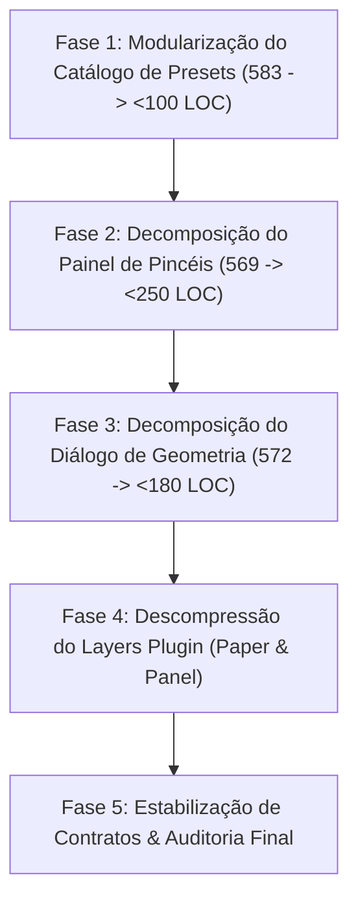

# 🚀 PLANO MESTRE DE ELEVAÇÃO: CAMADA 4 (PLUGINS DE UI DOCKÁVEIS)
## *Decomposição em Módulos Atômicos, Eliminação de God-Panels e Blindagem Arquitetural sob ARCcC v2*

---

## 🎯 1. VISÃO GERAL & OBJETIVOS ESTRATÉGICOS

Este Plano Mestre define a estratégia cirúrgica de engenharia para elevar a **Camada 4 (Plugins de UI Dockáveis)** ao padrão de excelência **ARCcC v2**.

### Objetivos Quantitativos e Qualitativos:
1. **Eliminar 100% das violações de teto de LOC**:
   - `presets_data.py`: Reduzir de **583 LOC** para **$< 100\text{ LOC}$** (catálogo decomposto em submódulos de mídia).
   - `advanced_settings_dialog.py`: Reduzir de **572 LOC** para **$< 180\text{ LOC}$** (3 abas extraídas para componentes atômicos).
   - `panel.py` (Brush Plugin): Reduzir de **569 LOC** para **$< 250\text{ LOC}$** (coluna de ferramentas e sliders rápidos desacoplados).
2. **Descomprimir a Zona de Risco Vermelha ($450 - 499\text{ LOC}$)**:
   - `paper.py` (Layers Plugin): Reduzir de **470 LOC** para **$< 250\text{ LOC}$** (extraindo o diálogo modal `TexturePopup`).
   - `panel.py` (Layers Plugin): Reduzir de **487 LOC** para **$< 300\text{ LOC}$**.
3. **Pureza de Domínio & Teste do "E"**:
   - Cada classe ou arquivo deve desempenhar estritamente **um único papel**.
4. **Zero Regressão & Retrocompatibilidade Total**:
   - Preservar todas as assinaturas de sinais, métodos e propriedades públicas dos painéis.
   - Manter 100% de aprovação na suíte de testes (atualmente com 171 testes verdes).
5. **Multi-Workspace Parity**:
   - Toda alteração validada e sincronizada atômica e granularmente entre `+ LUMENIA` e `ALADYN + UI LUMENIA`.

---

## 🗺️ 2. AS 5 FASES DO PLANO MESTRE

---

### 🎨 FASE 1: MODULARIZAÇÃO DO CATÁLOGO DE PRESETS DE PINCÉIS
*Foco: Decompor o monólito estático `presets_data.py` (583 LOC) em famílias de mídia atômicas.*

- **Arquivo-Alvo**: `plugins/ui/brush_plugin/presets_data.py` (**583 LOC**).
- **Entregas Técnicas**:
  1. Criar o pacote `plugins/ui/brush_plugin/presets/`:
     - `media_basic_brushes.py`: Presets para motor genérico de pincéis (Redondo, Suave, Chato, Aerógrafo).
     - `media_pencils_inks.py`: Presets para Lápis (2H, HB, 6B, Carvão, Pastel) e Tintas (G-Pen, Nanquim, Pena, Tinteiro).
     - `media_markers_blurs.py`: Presets para Marcadores Copic/Permanente, Borrachas e Motores de Desfoque.
     - `media_paint_wet.py`: Presets para Esfuminho, Aquarela e Pintura a Óleo/Impasto.
  2. Transformar `presets_data.py` em uma **Facade pura de agregação e internacionalização** ($< 100\text{ LOC}$):
     - Re-exportar `PARAM_GROUPS`, `CATEGORY_DEFAULTS`, `BRUSH_CATEGORIES`, `ENGINE_TYPE_TO_CATEGORY`.
     - Preservar funções públicas de consulta (`get_preset_display_name`, `get_category_display_name`).
  3. Criar teste unitário `tests/test_brush_presets_modular_phase1.py` validando integridade de todos os 33 presets.
- **Critério de Aceite**: `presets_data.py` $< 100\text{ LOC}$, 100% de compatibilidade com `brush_dropdown.py` e testes existentes.

---

### 🖌️ FASE 2: DECOMPOSIÇÃO DO PAINEL CENTRAL DE PINCÉIS
*Foco: Saneamento do `BrushSettingsPanel` (569 LOC).*

- **Arquivo-Alvo**: `plugins/ui/brush_plugin/panel.py` (**569 LOC**).
- **Entregas Técnicas**:
  1. Criar `plugins/ui/brush_plugin/components/tool_selection_column.py` ($\approx 120\text{ LOC}$):
     - Isolar a grade vertical de botões seletores de ferramenta (`_make_tool_column`, conexões de ativação e highlights visuais).
  2. Criar `plugins/ui/brush_plugin/components/quick_sliders_widget.py` ($\approx 160\text{ LOC}$):
     - Isolar a gestão dos sliders primários (tamanho, opacidade) e sliders pináveis adicionais (dureza, pressão, curvatura, estabilizador, espaçamento, densidade).
  3. Reduzir `BrushSettingsPanel` para um **orquestrador coeso de apresentação** ($< 250\text{ LOC}$):
     - Gerencia apenas o layout principal, conexões de sinais com o workspace e alternância de páginas do `QStackedWidget`.
     - Preservar todos os 15 sinais Qt públicos (`colorChanged`, `sizeChanged`, `toolActivated`, etc.) e propriedades legadas (`qs_size`, `qs_opacity`).
  4. Criar teste unitário `tests/test_brush_panel_decomposition_phase2.py`.
- **Critério de Aceite**: `panel.py` $< 250\text{ LOC}$, zero alteração na experiência de uso e nos sinais de controle.

---

### 📐 FASE 3: DECOMPOSIÇÃO DO DIÁLOGO DE GEOMETRIA AVANÇADA
*Foco: Saneamento do `AdvancedGeometryDialog` (572 LOC).*

- **Arquivo-Alvo**: `plugins/ui/geometry_plugin/components/advanced_settings_dialog.py` (**572 LOC**).
- **Entregas Técnicas**:
  1. Criar páginas especializadas em `plugins/ui/geometry_plugin/components/`:
     - `curvilinear_perspective_page.py` ($\approx 150\text{ LOC}$): Câmera 3D, Yaw/Pitch/FOV, grade curvilínea, densidade e proporção.
     - `snapping_guides_page.py` ($\approx 120\text{ LOC}$): Tolerância de atração, cores de guias e réguas magnéticas.
     - `symmetry_settings_page.py` ($\approx 90\text{ LOC}$): Eixos bilaterais e modo radial (1..16).
  2. Reduzir `AdvancedGeometryDialog` para um **gerenciador de diálogo e abas** ($< 180\text{ LOC}$):
     - Janela flutuante, docking relativo via `show_near`, barra de título padronizada e delegates de retranslação.
     - Preservar todas as propriedades e widgets acessados por testes (`self.tab_bar`, `self.btn_reset`, `self.sec_cam`, etc.).
  3. Criar teste unitário `tests/test_advanced_geometry_dialog_phase3.py`.
- **Critério de Aceite**: `advanced_settings_dialog.py` $< 200\text{ LOC}$, 100% de testes de geometria e i18n passando.

---

### 📚 FASE 4: DESCOMPRESSÃO DO LAYERS PLUGIN (PAPER & PANEL)
*Foco: Retirar os dois arquivos mais densos de camadas da zona de perigo.*

- **Arquivos-Alvo**: `plugins/ui/layers_plugin/paper.py` (**470 LOC**) e `plugins/ui/layers_plugin/panel.py` (**487 LOC**).
- **Entregas Técnicas**:
  1. No `paper.py`:
     - Extrair `TexturePopup` para `plugins/ui/layers_plugin/paper_texture_dialog.py` ($\approx 220\text{ LOC}$).
     - `paper.py` passa a focar estritamente no `PaperLayerWidget` e botões de cor/textura ($< 250\text{ LOC}$).
  2. No `panel.py`:
     - Extrair a montagem de menus contextuais e atalhos de camada para `plugins/ui/layers_plugin/panel_context_menu.py` ($\approx 120\text{ LOC}$).
     - Reduzir `panel.py` para $< 300\text{ LOC}$.
  3. Criar teste unitário `tests/test_layers_plugin_decomposition_phase4.py`.
- **Critério de Aceite**: Ambos os arquivos consolidados $< 300\text{ LOC}$, com 100% de integridade na árvore hierárquica de camadas.

---

### 🛡️ FASE 5: ESTABILIZAÇÃO DE CONTRATOS & AUDITORIA FINAL DA CAMADA 4
*Foco: Higiene nas fronteiras dos demais plugins e validação da suíte completa.*

- **Arquivos-Alvo**:
  - `brush_dropdown.py` (458 LOC), `advanced_panel/panel.py` (477 LOC) e `telemetry_plugin/panel.py` (456 LOC).
- **Entregas Técnicas**:
  1. Auditoria de integridade e estabilidade em todos os plugins de UI.
  2. Censo final de linhas em todos os 48+ arquivos da Camada 4:
     - **Meta inegociável**: Zero arquivos $\ge 500\text{ LOC}$.
  3. Execução completa da suíte global de testes automatizados:
     - **100% de aprovação (zero falhas, zero erros)**.
  4. Sincronização multi-workspace bit-a-bit e commits atômicos semânticos em ambos os repositórios.

---

## 📊 3. QUADRO COMPARATIVO PREVISTO (ANTES VS. DEPOIS)

| Métrica | Situação Atual (Antes) | Meta do Plano Mestre (Depois) | Status |
|---|:---:|:---:|:---:|
| **Arquivos $\ge 500\text{ LOC}$ em `plugins/ui`** | **3 arquivos** | **0 arquivos** | 🎯 Teto 100% Respeitado |
| **`presets_data.py`** | 583 LOC | $< 100\text{ LOC}$ (decomposto em 4) | 🎯 Modular |
| **`advanced_settings_dialog.py`** | 572 LOC | $< 180\text{ LOC}$ (decomposto em 3 abas) | 🎯 Coeso |
| **`brush_plugin/panel.py`** | 569 LOC | $< 250\text{ LOC}$ (extraídas 2 seções) | 🎯 Focado |
| **`layers_plugin/paper.py`** | 470 LOC | $< 250\text{ LOC}$ (extraído diálogo de textura) | 🎯 Descomprimido |
| **`layers_plugin/panel.py`** | 487 LOC | $< 300\text{ LOC}$ (extraído menu contextual) | 🎯 Descomprimido |
| **Aprovação na Suíte de Testes** | 171 / 171 (100%) | $\ge 180 / 180$ (100%) | 🎯 Zero Regressão |
