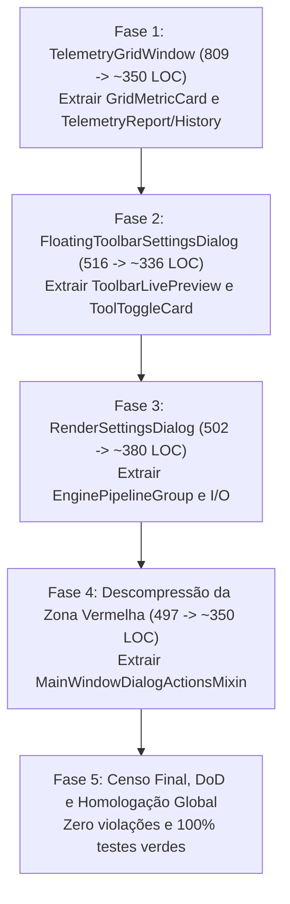

# 🏛️ PLANO MESTRE DE ELEVAÇÃO ARCcC v2: CAMADA 5 (SHELL, NÚCLEO UI & DIÁLOGOS)
## *Estratégia de Fatiamento Atômico, Descompressão de Código e Homologação de Contratos*

---

## 🎯 OBJETIVOS DA OPERAÇÃO

1. **Teto Estrito de LOC**: Garantir que absolutamente nenhum arquivo em `ui/` possua $\ge 500\text{ LOC}$.
2. **Descompressão Preventiva**: Reduzir os 3 arquivos críticos ($\ge 500\text{ LOC}$) e o arquivo da zona vermelha (`main_window_menu_actions.py`, 497 LOC) para a faixa de $300 - 380\text{ LOC}$.
3. **Pureza de Domínio (ARCcC v2)**: Isolar widgets reutilizáveis (`GridMetricCard`, `ToolToggleCard`, `ToolbarLivePreview`), separando-os dos contêineres de diálogo e loops de eventos.
4. **Retrocompatibilidade Absoluta**: Nenhuma assinatura pública, sinal Qt, propriedade ou exportação legada pode ser quebrada.
5. **Paridade Multi-Workspace**: Todos os passos de elevação devem ser sincronizados e comitados paritariamente nos repositórios Principal (`+ LUMENIA`) e Espelho (`ALADYN + UI LUMENIA`).

---

## 📋 CRONOGRAMA DE EXECUÇÃO EM 5 FASES

---

### 🔹 FASE 1: Decomposição Atômica do Cockpit de Telemetria (`telemetry_grid_window.py`)
- **Arquivo de Origem**: `ui/core/dialogs/telemetry_grid_window.py` (809 LOC).
- **Sub-etapa 1.1 — Extração do Card Métrico**:
  - Criar `ui/core/widgets/metric_card.py` (~130 LOC) contendo `GridMetricCard(QtWidgets.QFrame)`.
  - Re-exportar em `ui/core/widgets/__init__.py` e em `telemetry_grid_window.py`.
- **Sub-etapa 1.2 — Extração do Gerador de Relatório e Diálogo de Histórico**:
  - Criar `ui/core/dialogs/telemetry_grid_report.py` (~170 LOC) contendo:
    - `TelemetryStateHistoryDialog(BaseFramelessDialog)`: janela modal para inspeção das transições de estado do pipeline.
    - `TelemetryReportGenerator`: formatador puro de telemetria com cálculo de porcentagens e geração de texto para cópia.
- **Sub-etapa 1.3 — Refatoração do Cockpit**:
  - `TelemetryGridWindow` passa a importar os componentes extraídos, focando exclusivamente na montagem do grid de 20 cards e no timer de 60 FPS.
  - Volume resultante: $\approx 350\text{ LOC}$ (redução de 56%).
- **Garantia de Qualidade**: Criar teste `tests/test_telemetry_grid_decomposition_phase1.py`.
- **Commit Paritário**: `refactor(ui): decompor TelemetryGridWindow em MetricCard e TelemetryReport sob padrao ARCcC (Fase 1)`

---

### 🔹 FASE 2: Decomposição Atômica da Barra Flutuante (`floating_toolbar_settings_dialog.py`)
- **Arquivo de Origem**: `ui/core/screens/floating_toolbar_settings_dialog.py` (516 LOC).
- **Sub-etapa 2.1 — Extração de Componentes Visuais**:
  - Criar `ui/core/screens/floating_toolbar_components.py` (~180 LOC) contendo:
    - `ToolbarLivePreview(QtWidgets.QFrame)`: moldura de pré-visualização em tempo real das ferramentas ativas.
    - `ToolToggleCard(QtWidgets.QFrame)`: cartão tátil com ícone, título traduzido e checkbox estilizado.
- **Sub-etapa 2.2 — Refatoração do Diálogo**:
  - `FloatingToolbarSettingsDialog` importa os componentes de `floating_toolbar_components.py` e re-exporta as classes para retrocompatibilidade.
  - Volume resultante: $\approx 336\text{ LOC}$ (redução de 35%).
- **Garantia de Qualidade**: Criar teste `tests/test_floating_toolbar_decomposition_phase2.py`.
- **Commit Paritário**: `refactor(ui): extrair componentes visuais de FloatingToolbarSettingsDialog (Fase 2)`

---

### 🔹 FASE 3: Decomposição Atômica das Configurações de Renderização (`render_settings_dialog.py`)
- **Arquivo de Origem**: `ui/core/dialogs/render_settings_dialog.py` (502 LOC).
- **Sub-etapa 3.1 — Consolidação em `render_settings_components.py`**:
  - Mover as rotinas de persistência `load_render_settings` e `save_render_settings` para `render_settings_components.py`.
  - Encapsular o bloco de controles do motor como `EnginePipelineGroup(QtWidgets.QGroupBox)` dentro de `render_settings_components.py` (~90 LOC adicionais).
  - O arquivo `render_settings_components.py` passará de 165 para $\approx 255\text{ LOC}$ (zona verde segura).
- **Sub-etapa 3.2 — Refatoração do Diálogo**:
  - `RenderSettingsDialog` passa a instanciar `EnginePipelineGroup`, reduzindo sua responsabilidade estrutural.
  - Volume resultante: $\approx 380\text{ LOC}$ (redução de 24%).
- **Garantia de Qualidade**: Executar `tests/test_dialogs_i18n.py` e teste dedicado de componentes.
- **Commit Paritário**: `refactor(ui): desacoplar EnginePipelineGroup e persistencia de RenderSettingsDialog (Fase 3)`

---

### 🔹 FASE 4: Descompressão da Zona Vermelha (`main_window_menu_actions.py`)
- **Arquivo de Origem**: `ui/boundary/orchestrator/main_window_menu_actions.py` (497 LOC).
- **Sub-etapa 4.1 — Segregação de Responsabilidades (Edição vs Diálogos)**:
  - Criar `ui/boundary/orchestrator/main_window_dialog_actions.py` (~140 LOC) com `MainWindowDialogActionsMixin`:
    - Métodos: `open_shortcuts_dialog`, `open_cursor_settings_dialog`, `open_feedback_form`, `open_about_dialog`, `open_test_report_dialog`, `open_user_guide`, `open_diagnostics_dialog`, `set_application_language`, `open_telemetry_grid_window`.
- **Sub-etapa 4.2 — Composição e Manutenção da API Pública**:
  - `MainWindowMenuActionsMixin` herda de `MainWindowDialogActionsMixin` (ou `MainWindow` herda de ambos), garantindo que qualquer chamada existente continue funcionando sem alteração em chamadores externos.
  - Volume resultante de `main_window_menu_actions.py`: $\approx 350\text{ LOC}$.
- **Garantia de Qualidade**: Criar teste `tests/test_main_window_actions_phase4.py`.
- **Commit Paritário**: `refactor(ui): segregar acoes de menu e abertura de dialogos da MainWindow (Fase 4)`

---

### 🔹 FASE 5: Auditoria Final, Definição de Pronto (DoD) e Homologação
- **Censo Completo da Camada 5**:
  - Executar script de contagem de LOC em todos os 137+ arquivos de `ui/`.
  - Critério de Aceite: **0 arquivos $\ge 500\text{ LOC}$**.
- **Execução da Suíte Completa de Testes**:
  - Executar `python -m pytest tests/` e certificar **100% dos testes verdes**.
- **Sincronização Documental**:
  - Copiar `DIAGNOSTICO_ARCcC_CAMADA_5_SHELL_NUCLEO_UI.md` e `PLANO_MESTRE_ELEVACAO_CAMADA_5_SHELL_NUCLEO_UI.md` para `docs/` no Primary e Mirror.
  - Atualizar `walkthrough.md`.
- **Commit Paritário Final**: `docs(arccc): registrar conclusao e homologacao da Camada 5 (Shell, Nucleo UI & Dialogos)`
