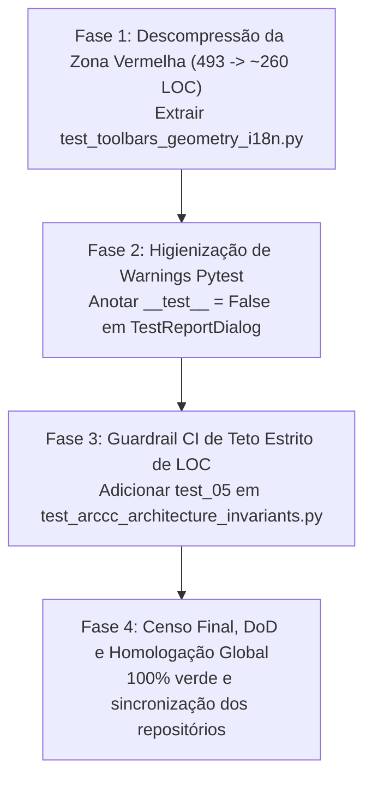

# 🏛️ PLANO MESTRE DE ELEVAÇÃO ARCcC v2: CAMADA 6 (SUÍTE DE TESTES AUTOMATIZADOS)
## *Estratégia de Descompressão de Testes, Higienização de Warnings e Guardrails CI Permanentes*

---

## 🎯 OBJETIVOS DA OPERAÇÃO

1. **Eliminar a Zona Vermelha da Camada 6**: Reduzir `tests/test_dialogs_i18n.py` (493 LOC) para $\approx 260\text{ LOC}$, trazendo 100% dos 41 arquivos de teste para a **Zona Verde Segura (< 300 LOC)**.
2. **Pureza de Domínio nos Testes**: Segregar os testes de internacionalização de diálogos do sistema dos testes de barras de ferramentas, opções contextuais e réguas geométricas.
3. **Higienização de Warnings**: Eliminar 100% dos `PytestCollectionWarning` adicionando `__test__ = False` nas classes UI do relatório de testes.
4. **Guardrail CI Automatizado Permanente**: Instituir em `test_arccc_architecture_invariants.py` a checagem automática e estrita de que **zero arquivos do projeto violam o teto de 500 LOC**, assegurando governança contínua contra a força entrópica.
5. **Paridade Multi-Workspace**: Manter todas as fases sincronizadas e comitadas paritariamente entre os repositórios Primary (`+ LUMENIA`) e Mirror (`ALADYN + UI LUMENIA`).

---

## 📋 CRONOGRAMA DE EXECUÇÃO EM 4 FASES

---

### 🔹 FASE 1: Descompressão da Zona Vermelha (`test_dialogs_i18n.py`)
- **Arquivo de Origem**: `tests/test_dialogs_i18n.py` (493 LOC).
- **Sub-etapa 1.1 — Extração dos Testes de Barras e Geometria**:
  - Criar `tests/test_toolbars_geometry_i18n.py` ($\approx 235\text{ LOC}$) contendo:
    - `test_01_secondary_toolbar_retranslation` (antigo `test_06`)
    - `test_02_settings_menu_retranslation` (antigo `test_07`)
    - `test_03_geometry_panel_icon_and_retranslation` (antigo `test_08`)
    - `test_04_advanced_geometry_dialog_retranslation` (antigo `test_09`)
    - `test_05_secondary_toolbar_shapes_transform_selection_retranslation` (antigo `test_12`)
- **Sub-etapa 1.2 — Refatoração de `test_dialogs_i18n.py`**:
  - Mantém com foco exclusivo os 8 testes de diálogos de sistema: Dock settings, Floating toolbar, Theme dialog, Render settings, Cursor & shortcuts, Theme dropdowns, Telemetry panel, Menubar dialogs.
  - Volume resultante: $\approx 260\text{ LOC}$ (redução de 47%, zona verde).
- **Commit Paritário**: `test(i18n): segregar testes de barras e geometria em test_toolbars_geometry_i18n sob padrao ARCcC (Fase 1)`

---

### 🔹 FASE 2: Higienização de Warnings de Coleta do Pytest
- **Arquivo de Origem**: `ui/core/dialogs/test_report_dialog.py`.
- **Ação**:
  - Adicionar `__test__ = False` nas classes `TestRunnerThread` e `TestReportDialog`.
- **Resultado**:
  - Execução de testes sem warnings de coleta desnecessários.
- **Commit Paritário**: `fix(tests): eliminar PytestCollectionWarning com flag __test__ = False (Fase 2)`

---

### 🔹 FASE 3: Guardrail CI de Teto Estrito de LOC Permanente
- **Arquivo de Origem**: `tests/test_arccc_architecture_invariants.py`.
- **Ação**:
  - Adicionar método de teste `test_05_strict_loc_ceiling_compliance`:
    - Varre todos os arquivos `.py` em `plugins/`, `ui/` e `tests/`.
    - Falha o teste se qualquer arquivo tiver $\ge 500\text{ LOC}$.
- **Resultado**:
  - Proteção perene e automatizada contra regressões do teto ARCcC.
- **Commit Paritário**: `test(arccc): adicionar guardrail CI automatizado para teto estrito de 500 LOC (Fase 3)`

---

### 🔹 FASE 4: Auditoria Final, Definição de Pronto (DoD) e Homologação
- **Censo Completo da Camada 6**:
  - Validar 100% dos arquivos de teste na Zona Verde Segura ($< 300\text{ LOC}$).
- **Execução Global da Suíte**:
  - Rodar suíte completa de testes (`python -m pytest tests/`).
- **Documentação e Commits Finais**:
  - Sincronizar `DIAGNOSTICO_ARCcC_CAMADA_6_SUITE_TESTES.md` e `PLANO_MESTRE_ELEVACAO_CAMADA_6_SUITE_TESTES.md` em `docs/`.
  - Atualizar `walkthrough.md`.
  - Commit final paritário em Primary e Mirror.
