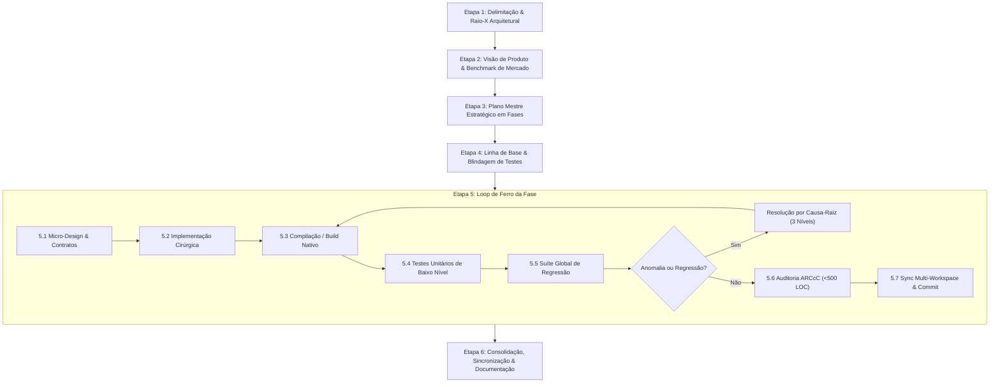
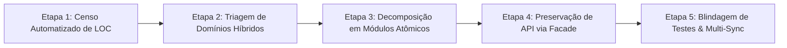

# 🏛️ WORKFLOW GERAL DE DESENVOLVIMENTO E ELEVAÇÃO ARCcC
## *Framework Operacional para Engenharia de Alta Performance, Refatoração Segura e Qualidade Competitiva de Software*

---

## 🧭 1. FILOSOFIA E PRINCÍPIOS FUNDAMENTAIS

Este documento formaliza o **método de trabalho sistemático** desenvolvido e validado ao longo da evolução da arquitetura do **Lumenia**. Ele foi desenhado para ser universalmente aplicável a qualquer subsistema do software — seja o **Motor C++ Nativo (Camada 1)**, o **Sistema de Ferramentas e Pincéis (Camada 2)**, o **Core do Workspace e Telas (Camada 3)**, ou o **Ecosistema de Plugins e UI (Camada 4)**.

### Os Três Pilares Inegociáveis:
1. **Engenharia Cirúrgica & Zero Regressão**: Nenhuma linha de código é alterada sem que haja clareza absoluta de seus impactos colaterais. Se um teste funcionava antes, ele continuará funcionando depois.
2. **Qualidade Concorrencial de Mercado**: Todo código, algoritmo e interface é projetado tendo como referência os padrões da indústria de ponta (Clip Studio Paint, Photoshop, Procreate, Krita).
3. **Conformidade Estrita com ARCcC**:
   - **Teto Absoluto de 500 Linhas de Código (LOC)** por arquivo (sem exceções).
   - **Arquitetura em Camadas Ortogonais**: Camadas superiores conhecem inferiores; camadas inferiores nunca dependem de superiores.
   - **Desacoplamento por Facades e Orquestradores**: Módulos complexos são divididos em componentes especializados, com interfaces públicas limpas e estritas.

---

## 🔄 2. O CICLO DE VIDA DO DESENVOLVIMENTO (MACRO-ETAPAS)



---

## 📋 3. GUIA PASSO A PASSO DETALHADO

### ETAPA 1: DELIMITAÇÃO & RAIO-X ARQUITETURAL (O CENSO)
Antes de escrever uma única linha de código, o sistema deve ser radiografado com precisão matemática.

- **Inventário de Arquivos e LOC**:
  - Listar todos os arquivos da área de foco com sua contagem de linhas atual.
  - Identificar arquivos "monolíticos" ou que excedem o teto de 500 LOC.
- **Mapeamento de Dependências**:
  - Mapear dependências externas, bibliotecas, headers órfãos ou código morto/não referenciado.
  - Mapear acoplamentos cruzados indesejados.
- **Contratos e Fronteiras**:
  - Quais APIs públicas esse subsistema expõe? Quem as consome?
- **Entregável Formal**: Criar o artefato/documento `docs/DIAGNOSTICO_ARCcC_[MODULO].md`.

---

### ETAPA 2: VISÃO DE PRODUTO & BENCHMARK COMPETITIVO
Um software de alto desempenho precisa atender às expectativas reais dos usuários profissionais.

- **Pergunta-Guia**: *"O que falta para este subsistema bater de frente com os líderes de mercado?"*
- **Análise de Fatores Sensoriais e de Desempenho**:
  - **Latência**: A resposta tátil/visual é imediata (< 16ms / 60-120 FPS)?
  - **Fidelidade e Artefatos**: Existem descontinuidades perceptivas, degraus de cor, bordas turvas ou falta de precisão sub-pixel?
  - **Escalabilidade**: O sistema aguenta trabalhar em condições extremas (ex: 4K, 600 DPI, pincéis de 1000px, 50 camadas, memória sob pressão)?
- **Lista de Diferenciais Competitivos**: Definir as 3 a 5 melhorias que transformarão o subsistema em referência técnica.

---

### ETAPA 3: O PLANO MESTRE ESTRATÉGICO EM FASES
Dividir a empreitada em fases incrementais, ortogonais e autolimitadas.

- **Estruturação Típica de 5 Fases**:
  - **Fase 1: Fundação & Higiene**: Limpeza de código morto, desacoplamento de arquivos gigantes (>500 LOC), contratos e interfaces formais.
  - **Fase 2: Capacidade Funcional & Fidelidade**: Novos algoritmos, dinâmica aprimorada, correção de lacunas conceituais.
  - **Fase 3: Performance & Throughput de Carga**: Vetorização (SIMD/AVX2), paralelismo (OpenMP), otimizações de cache e estruturas de dados.
  - **Fase 4: Escalabilidade & Gestão de Recursos**: Compressão em tempo real (ex: LZ4), Copy-on-Write ($O(1)$), paginação de memória/disco.
  - **Fase 5: Aceleração de Hardware & Apresentação**: Pipelines de Viewport (OpenGL/GPU), dirty tiles, culling e resposta de 120 FPS.
- **Critérios de Aceite Inegociáveis**: Toda fase deve definir exatamente:
  1. Entregáveis técnicos esperados.
  2. Teste automatizado de validação.
  3. Garantia de limite de LOC por arquivo.
- **Entregável Formal**: Criar o documento `docs/PLANO_MESTRE_[OBJETIVO].md`.

---

### ETAPA 4: LINHA DE BASE & BLINDAGEM DE TESTES
- **Execução da Suíte Existente**: Rodar a suíte global de testes (`discover tests`). Todos os testes devem passar (100%).
- **Commit de Ponto de Partida**:
  - `git commit -m "chore: baseline antes do plano mestre [modulo]"`
  - Isso garante um ponto seguro de restauração (rollback) se necessário.

---

### ETAPA 5: O LOOP DE FERRO DA EXECUÇÃO (POR FASE)
Para cada fase do plano, execute a sequência rigorosa a seguir:

#### 5.1. Micro-Design e Decomposição Preventiva
- Projete as novas classes/módulos mantendo a responsabilidade única.
- Se uma classe existente tiver 400+ linhas e for receber código novo, **decomponha-a primeiro** criando um orquestrador ou módulo auxiliar para nunca ultrapassar 500 linhas.

#### 5.2. Implementação Cirúrgica
- Escreva código moderno (C++17/20, Python 3.12+ tipado).
- Minimize alocações dinâmicas no caminho crítico de execução.
- Respeite as fronteiras de isolamento (APIs públicas estáveis).

#### 5.3. Build & Compilação Limpa
- Recompile módulos nativos/extensões (`setup.py build_ext --inplace` ou CMake).
- Exija **zero erros** e **zero warnings críticos**.

#### 5.4. Criação de Testes de Baixo Nível da Fase
- Crie um arquivo dedicado `tests/test_lowlevel_phaseX_[nome].py`.
- Cubra:
  - Testes de estresse e casos de borda (resoluções extremas, buffers vazios/cheios, concorrência).
  - Fidelidade matemática (tolerâncias analíticas `assertAlmostEqual`).
  - Performance e invariantes de estado.

#### 5.5. Bateria Global de Regressão
- Execute toda a suíte de testes do repositório:
  ```bash
  python -m unittest discover tests
  ```
- **Aprovação de 100% Obrigatória**: Nenhuma falha é aceitável para avançar.

#### 5.6. Protocolo de Resolução de Anomalias (O Método dos 3 Níveis)
Caso surja uma falha visual, artefato perceptivo ou comportamento inesperado durante a fase:
1. **Nível Físico/Matemático**: Analise os valores numéricos reais dos pixels ou dados. Verifique curvas de transferência (ex: sRGB gamma, clampings, divisões inteiras truncadas).
2. **Nível Algorítmico**: Verifique partições de loop, condições de contorno de matrizes/tiles, fast-paths com suposições incorretas.
3. **Nível Estrutural**: Verifique ordens de interpolação, acúmulo de erros de ponto flutuante ou desalinhamento de memória.
- Isole o problema com um teste reprodutível e corrija-o na causa-raiz, nunca com "gambiarras" superficiais.

#### 5.7. Auditoria Estrita ARCcC
- Execute verificação de linhas de código em todos os arquivos modificados/criados:
  - Nenhum arquivo pode ter $\ge 500\text{ LOC}$.

#### 5.8. Sincronização Multi-Workspace
- Se o projeto mantiver ambientes espelho (ex: Workspace Principal + Workspace de Produção/Testes):
  - Copie fielmente arquivos fontes, headers, binários compilados (`.pyd`) e testes.

#### 5.9. Git Commit Granular
- Realize o commit da fase com mensagem semântica detalhada:
  ```bash
  git commit -m "feat([modulo]): Fase X - [Titulo Descritivo] (detalhes tecnicos)"
  ```
- Garanta que a árvore de trabalho de ambos os repositórios fique limpa (`working tree clean`).

---

### ETAPA 6: CONSOLIDAÇÃO E GESTÃO DE CONHECIMENTO
- **Atualização do Walkthrough**: Registrar formalmente o progresso concluído, tabelas de métricas comparativas e decisões de design.
- **Revisão de Desempenho**: Comparar o antes e depois em velocidade, uso de memória e sensação de uso.
- **Pronto para a Próxima Fronteira**: O subsistema agora está estabilizado, testado e documentado no padrão do estado da arte.

---

## 🧠 4. A REGRA DA COESÃO DE DOMÍNIO: POR QUE < 500 LOC NÃO É SUFICIENTE

O teto de **$< 500\text{ LOC}$ (Regra 4)** é uma barreira mecânica fundamental contra classes monolíticas de milhares de linhas. No entanto, ela é uma métrica **quantitativa**, e não **qualitativa**. 

Um arquivo pode ter 250 ou 450 linhas e ainda assim ser uma **"God Class compactada"** ou um **"Canivete Suíço em miniatura"**, onde 4 ou 5 domínios técnicos completamente distintos dividem o mesmo espaço de memória, as mesmas variáveis de instância e o mesmo ciclo de vida. 

> [!CAUTION]
> **A Causa Oculta das Regressões**: A maioria dos bugs inseridos durante refatorações não nasce da quantidade de linhas, mas sim do **acúmulo de responsabilidades concorrentes** em um mesmo arquivo. Ao ajustar a lógica de um domínio $A$, quebram-se silenciosamente os invariantes ou o estado compartilhado do domínio $B$.

---

### Os 4 Sintomas do Acúmulo de Papéis Distintos:

1. **Acoplamento de Invariantes Incompatíveis**:
   - *Caso Real Lumenia*: Em `BlendEquations.hpp`, a mesma equação era usada para compor camadas independentes (que exige espaço linear sRGB) e acumular carimbos de um único traço de pincel (onde a curva sRGB de 8 bits gerava um degrau artificial de $R=13 \rightarrow 0$ no miolo).
2. **Estado Compartilhado e Efeitos Colaterais Temporais**:
   - Flags e variáveis mutáveis (`m_isDrawing`, `_cursor_in_viewport`, `m_lastDab`) manipuladas por múltiplos fluxos. A mutação de estado por uma ferramenta contamina a execução da próxima.
3. **Raio de Destruição Expandido (*Blast Radius*)**:
   - Quando um arquivo concentra múltiplos papéis (ex: `PaintEngineFacade` gerenciando 9 domínios ou `render_widget.py` orquestrando 7 ferramentas e o contexto OpenGL), qualquer alteração pontual força recompilações massivas e expõe o sistema a regressões em áreas não relacionadas.
4. **Névoa Cognitiva (*Context Overload*)**:
   - O desenvolvedor ou agente de IA precisa manter múltiplos modelos mentais concorrentes para editar um único arquivo, aumentando exponencialmente a chance de suposições errôneas.

---

### As 3 Regras Qualitativas ARCcC (Nível 2 de Maturidade):

#### 🎯 Regra Q1: O Teste do "E" (*Single Responsibility Audit*)
Se para explicar a função de uma classe ou arquivo você precisar utilizar a conjunção **"E"**, a classe viola o princípio de responsabilidade única e **deve ser decomposta**, mesmo que tenha menos de 200 linhas:
- ❌ *Incorreto*: "O `TileGrid` armazena a matriz de tiles **E** rastreia regiões sujas para a GPU **E** faz coleta de lixo de blocos vazios."
- ✅ *Correto*:
  - `TileStorage`: Apenas aloca e indexa os ponteiros de memória $(x, y)$.
  - `TileDirtyTracker`: Apenas registra o conjunto de coordenadas modificadas.
  - `TileMemoryPruner`: Apenas varre e recicla blocos transparentes.

#### 📦 Regra Q2: Separação Estrita de Estado e Algoritmo (*Data vs. Logic*)
Estruturas de dados básicas (matrizes de bytes, buffers, descritores de geometria) **não devem conter lógica de apresentação, orquestração de GPU ou persistência em disco**. Lógicas avançadas devem atuar sobre as estruturas como serviços desacoplados ou observadores.

#### ⏱️ Regra Q3: Isolamento por Causa e Frequência de Mudança (*Change Reason Isolation*)
Componentes que mudam por motivos e frequências distintas nunca devem residir no mesmo módulo:
- Cálculos matemáticos puros e determinísticos (ex: projeção de matrizes de perspectiva 3D ou interpolação de curvas Bézier) **quase nunca mudam**.
- Estilos visuais, espessuras, cores de linhas de interface e comportamento de menus **mudam frequentemente** com base no feedback de design.
- *Eles devem viver em arquivos estritamente separados*.

---

## 🔄 5. O PROTOCOLO DE AUDITORIA CONTÍNUA E SANEAMENTO ARCcC (VIGILÂNCIA ARQUITETURAL RECORRENTE)
### *Como combater a degradação entrópica e garantir a qualidade e pureza permanente da arquitetura*

A adesão aos princípios da metodologia **ARCcC** não se encerra quando uma refatoração pontual é concluída. Em um software comercial vivo, o código sofre **degradação entrópica natural** à medida que novas features, ferramentas, atalhos, opções de barra e correções pontuais são adicionados ao longo do tempo.

Arquivos que outrora eram coesos passam a incorporar pequenas rotinas de suporte: diálogos do sistema operacional, timers auxiliares, cálculos geométricos locais, persistência de preferências de UI ou orquestrações de múltiplos subsistemas. Mesmo que esses arquivos respeitem numericamente o teto de 500 linhas de código (LOC), eles se transformam em **"God Classes compactadas"** — e tornam-se a principal fonte de regressões e "bugs fantasmas" em ciclos futuros.

> [!IMPORTANT]
> **Diretriz de Engenharia Permanente**: O Saneamento ARCcC **não é uma intervenção emergencial única**, mas um **rito de engenharia contínuo e obrigatório**. Assim como a suíte de testes automatizados roda a cada ciclo, a auditoria de coesão e o censo de LOC devem ser executados regularmente para manter a integridade arquitetural no padrão do estado da arte.

---

### 5.1 Os Três Gatilhos do Rito de Saneamento

Todo engenheiro ou agente que atue no ecossistema Lumenia deve acionar o protocolo de saneamento diante de qualquer um dos três gatilhos:

1. **Gatilho 1 (Preventivo - Censo Quantitativo de Linhas)**:
   - **Faixa Segura ($< 300\text{ LOC}$)**: Módulo focado, manutenção e revisão triviais.
   - **Zona de Alerta Amarela ($300 - 450\text{ LOC}$)**: O arquivo atingiu massa crítica. Nenhuma nova funcionalidade pode ser adicionada sem avaliar a extração preventiva de submódulos.
   - **Zona Crítica Vermelha ($\ge 450\text{ LOC}$)**: Decomposição **obrigatória imediata**. O arquivo está proibido de receber novas linhas de lógica até ser fracionado em componentes atômicos.

2. **Gatilho 2 (Qualitativo - O Teste do "E" em Tarefas de Manutenção)**:
   - Ao abrir qualquer arquivo para implementar uma alteração (por menor que seja), deve-se formular a pergunta: *"Este arquivo desempenha mais de um domínio ou responsabilidade?"*.
   - Se a resposta contiver a conjunção "E" (ex: "o arquivo sincroniza eventos de pincel **E** abre diálogos do OS para carregar texturas em disco", como em `workspace_brush_adapter.py`), a separação é compulsória antes ou durante a tarefa.

3. **Gatilho 3 (Periódico - Varredura de Fim de Ciclo/Camada)**:
   - Ao final de cada ciclo de desenvolvimento ou marco de entrega de uma Camada arquitetural, executa-se a varredura global automatizada em todos os diretórios do subsistema.

---

### 5.2 O Roteiro Operacional em 5 Etapas (Validado nas Camadas 1 e 3)

O processo de saneamento recorrente segue um fluxo cirúrgico padronizado em 5 etapas:



#### Etapa 1: Censo Automatizado de LOC
Executar o script auditor de contagem de linhas no diretório-alvo para mapear o ranking decrescente de tamanho e detectar antecipadamente anomalias:
```bash
# Script de varredura rápida (PowerShell / Bash):
python -c "import pathlib; p = pathlib.Path('plugins/system/workspace_core'); files = [(f, len(f.read_text(encoding='utf-8', errors='ignore').splitlines())) for f in p.rglob('*.py') if '__pycache__' not in str(f)]; files.sort(key=lambda x: x[1], reverse=True); [print(f'{c:4d} LOC : {f}') for f, c in files if c > 250]"
```

#### Etapa 2: Triagem de Domínios Híbridos (Mapeamento dos 5 Hibridismos Clássicos)
Identificar e classificar os hibridismos acumulados no arquivo. Os 5 padrões clássicos identificados no projeto são:
- **Hibridismo A (Matemática Pura vs. Apresentação Gráfica)**:
  - *Sintoma*: Cálculos analíticos (projeções 3D, transformações esféricas, matrizes) dentro de widgets ou classes de pintura.
  - *Solução*: Isolar a matemática em funções e classes puras sem dependência de Qt/UI (ex: `camera_3d_projector.py`, `curvilinear_mesh_builder.py`).
- **Hibridismo B (Diálogos de Sistema / I/O de Disco vs. Adaptadores de Eventos)**:
  - *Sintoma*: Chamadas a `QFileDialog`, `QMessageBox` ou leitura de disco dentro de classes de despacho de sinais em tempo real.
  - *Solução*: Extrair a responsabilidade de I/O para um módulo auxiliar dedicado (ex: `brush_texture_io.py`).
- **Hibridismo C (Mixins Monolíticos Multiferramenta)**:
  - *Sintoma*: Uma única classe mixin com dezenas de métodos gerenciando 4 a 6 ferramentas distintas (ex: varinha, texto, balde, transformações).
  - *Solução*: Fatiar o mixin em mixins coesos por família de ferramentas (ex: `selection_toolbar_handlers.py`, `shape_text_toolbar_handlers.py`, `brush_fill_toolbar_handlers.py`).
- **Hibridismo D (Animação / Persistência / Geometria vs. Apresentação)**:
  - *Sintoma*: Um widget ou dock gerenciando simultaneamente layouts, animações cúbicas temporizadas, serialização de JSON e renderização de controles.
  - *Solução*: Extrair calculadoras analíticas (`dock_geometry_calculator.py`), armazenadores de estado (`dock_state_store.py`) e animadores (`dock_animator.py`).
- **Hibridismo E (Gerenciador de Ciclo de Vida de Ferramentas vs. Viewport de Canvas)**:
  - *Sintoma*: O widget de renderização instanciando, inicializando e alternando diretamente controladores de ferramentas e pipelines de traço.
  - *Solução*: Delegar para um orquestrador desacoplado (`tool_manager.py`, `canvas_stroke_pipeline.py`).

#### Etapa 3: Decomposição em Módulos Atômicos
- Criar submódulos dedicados em subpastas de domínio (ex: `math/`, `renderers/`, `handlers/`, `dock/`, `tools/`).
- Cada novo módulo deve ter escopo extremamente delimitado, com meta preferencial $< 250\text{ LOC}$.
- Proibir a replicação de dependências desnecessárias (manter o número de imports no mínimo estrito).

#### Etapa 4: Preservação de API Pública via Facade (Zero Breaking Changes)
- O arquivo original **nunca deve ser deletado sumariamente** se ele fizer parte do contrato público com outras camadas.
- Ele deve ser transformado em uma **Facade transparente** ou classe composta enxuta (como `geometry_overlay_renderer.py` reduzido para 75 LOC ou `toolbar_handlers.py` para 21 LOC).
- Todos os métodos públicos, sinais Qt, propriedades e slots continuam existindo no mesmo local, apenas delegando a chamada para os novos componentes especializados.
- Resultado: **zero impacto e zero quebra para o restante do ecossistema**.

#### Etapa 5: Blindagem de Testes com Sincronização Bidirecional & Paridade Multi-Workspace
1. **Criação de Testes Unitários de Domínio**:
   - Cada novo submódulo ganha uma bateria de testes unitários dedicada em `tests/test_[dominio]_[fase].py`.
   - Testar o comportamento nominal, casos de borda e tratamento gracioso de cancelamento/nulos.
2. **Validação de Sincronização Bidirecional**:
   - Em componentes interativos (ex: sliders horizontais e verticais, caches de parâmetros), garantir que a atualização programática ou via interface reflita perfeitamente no modelo interno e no widget espelho.
3. **Execução da Suíte Global de Regressão**:
   - Rodar `python -m unittest discover tests`.
   - **Critério inegociável**: 100% de testes verdes (0 falhas, 0 erros).
4. **Sincronização Imediata com Repositórios Espelho**:
   - Replicar código fonte, testes e scripts para todos os workspaces vinculados (ex: `+ LUMENIA` e `ALADYN + UI LUMENIA`).
   - Validar execução dos testes no repositório espelho.
5. **Commit Atômico e Granular**:
   - Registrar no git commits semânticos por fase (`refactor(...)`), registrando claramente no log a redução de LOC e os novos submódulos introduzidos.

---

## 📐 6. TABELA DE REGRAS E LIMITES ARCcC (QUANTITATIVAS & QUALITATIVAS)

| Elemento | Limite / Regra | Tipo | Ação em Caso de Violação |
|---|:---:|:---:|---|
| **Tamanho Máximo de Arquivo** | **< 500 Linhas** (C++ e Python) | Quantitativo | Decompor imediatamente em sub-módulos ou orquestradores. |
| **Zona de Alerta Preventiva** | **300 a 450 Linhas** | Preventivo | Planejar extração de submódulos antes de novas features. |
| **Pureza de Responsabilidade** | **1 Único Domínio** (Teste do "E") | Qualitativo | Extrair os papéis secundários para classes/módulos especializados. |
| **Separação Dados / Apresentação** | **Zero lógica de UI em Core** | Arquitetural | Isolar modelos de dados de rotinas de pintura e shaders. |
| **Preservação de Contratos** | **100% Retrocompatível** | Arquitetural | Manter Facades e delegar chamadas sem quebrar clientes. |
| **Taxa de Aprovação de Testes** | **100%** (Zero regressões) | Rigor | Bloquear o avanço até a regressão ser solucionada na causa-raiz. |
| **Arquivos Órfãos / Código Morto** | **0** | Higiene | Deletar headers não utilizados e unificar interfaces redundantes. |
| **Alocações no Loop Crítico** | **Zero Alocação Dinâmica** | Performance | Utilizar memória pré-alocada, stack, LUTs ou pools de buffers. |
| **Compatibilidade de Fallback** | **100% Graceful Degradation** | Robustez | Chavear para caminho escalar/CPU seguro se hardware não suportar. |
| **Commits Git** | **Granulares por Fase / Feature** | Governança | Nunca misturar mudanças de contextos distintos no mesmo commit. |

---

## 🛠️ 7. TEMPLATES REUTILIZÁVEIS

### Template para Nomenclatura de Arquivos de Teste de Fase
```text
tests/test_[dominio]_decomposition_phase[N].py
```

### Template para Mensagem de Commit de Fase
```text
refactor([camada]): Fase [N] - [Nome da Fase] ([Principais Técnicas Empregadas])

- [Item 1 decomposto / extraído]
- [Item 2 preservado como Facade]
- Suíte de testes: X/X aprovados. Regressão global: 100% aprovada.
- Conformidade ARCcC: Todos os arquivos < 500 LOC (maior arquivo com Y LOC).
```

### Template de Checklist de Definição de Pronto (Definition of Done)
- [ ] Especificação técnica e matemática validada contra líderes de mercado.
- [ ] Censo de LOC executado: Zero arquivos $\ge 500\text{ LOC}$; arquivos mantidos preferencialmente $< 300\text{ LOC}$.
- [ ] Teste do "E" aplicado: Zero arquivos com domínios híbridos concorrentes.
- [ ] Preservação integral de contratos públicos através de Facades limpas.
- [ ] Código compilado limpo sem erros ou advertências graves.
- [ ] Testes unitários do submódulo criados e 100% aprovados.
- [ ] Suíte global de regressão 100% verde (0 falhas, 0 erros).
- [ ] Sincronização multi-workspace validada com execução de testes no espelho.
- [ ] Commit atômico e semântico registrado no controle de versão de ambos os ambientes.

