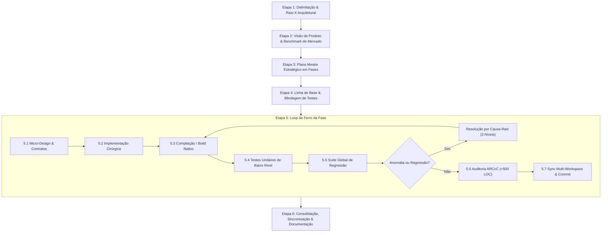

# 🏛️ WORKFLOW GERAL DE DESENVOLVIMENTO E ELEVAÇÃO ARCcC
## *Framework Operacional para Engenharia de Alta Performance, Refatoração Segura e Qualidade Competitiva de Software*

---

## 🧭 1. FILOSOFIA E PRINCÍPIOS FUNDAMENTAIS

Este documento formaliza o **método de trabalho sistemático** desenvolvido e validado ao longo da evolução da arquitetura do **Lumenia**. Ele foi desenhado para ser universalmente aplicável a qualquer subsistema do software — seja o **Motor C++ Nativo (Camada 1)**, o **Sistema de Ferramentas e Pincéis (Camada 2)**, o **Core do Workspace e Telas (Camada 3)**, ou o **Ecosistema de Plugins e UI (Camada 4)**.

### Os Três Pilares Inegociáveis:
1. **Engenharia Cirúrgica & Zero Regressão**: Nenhuma linha de código é alterada sem que haja clareza absoluta de seus impactos colaterais. Se um teste funcionava antes, ele continuará funcionando depois.
2. **Qualidade Concorrencial de Mercado**: Todo código, algoritmo e interface é projetado tendo como referência os padrões da indústria de ponta (Clip Studio Paint, Photoshop, Procreate, Krita).
3. **Conformidade Estrita com ARCcC**:
   - **Teto Absoluto de 500 Linhas de Código (LOC)** por arquivo (sem exceções).
   - **Arquitetura em Camadas Ortogonais**: Camadas superiores conhecem inferiores; camadas inferiores nunca dependem de superiores.
   - **Desacoplamento por Facades e Orquestradores**: Módulos complexos são divididos em componentes especializados, com interfaces públicas limpas e estritas.

---

## 🔄 2. O CICLO DE VIDA DO DESENVOLVIMENTO (MACRO-ETAPAS)



---

## 📋 3. GUIA PASSO A PASSO DETALHADO

### ETAPA 1: DELIMITAÇÃO & RAIO-X ARQUITETURAL (O CENSO)
Antes de escrever uma única linha de código, o sistema deve ser radiografado com precisão matemática.

- **Inventário de Arquivos e LOC**:
  - Listar todos os arquivos da área de foco com sua contagem de linhas atual.
  - Identificar arquivos "monolíticos" ou que excedem o teto de 500 LOC.
- **Mapeamento de Dependências**:
  - Mapear dependências externas, bibliotecas, headers órfãos ou código morto/não referenciado.
  - Mapear acoplamentos cruzados indesejados.
- **Contratos e Fronteiras**:
  - Quais APIs públicas esse subsistema expõe? Quem as consome?
- **Entregável Formal**: Criar o artefato/documento `docs/DIAGNOSTICO_ARCcC_[MODULO].md`.

---

### ETAPA 2: VISÃO DE PRODUTO & BENCHMARK COMPETITIVO
Um software de alto desempenho precisa atender às expectativas reais dos usuários profissionais.

- **Pergunta-Guia**: *"O que falta para este subsistema bater de frente com os líderes de mercado?"*
- **Análise de Fatores Sensoriais e de Desempenho**:
  - **Latência**: A resposta tátil/visual é imediata (< 16ms / 60-120 FPS)?
  - **Fidelidade e Artefatos**: Existem descontinuidades perceptivas, degraus de cor, bordas turvas ou falta de precisão sub-pixel?
  - **Escalabilidade**: O sistema aguenta trabalhar em condições extremas (ex: 4K, 600 DPI, pincéis de 1000px, 50 camadas, memória sob pressão)?
- **Lista de Diferenciais Competitivos**: Definir as 3 a 5 melhorias que transformarão o subsistema em referência técnica.

---

### ETAPA 3: O PLANO MESTRE ESTRATÉGICO EM FASES
Dividir a empreitada em fases incrementais, ortogonais e autolimitadas.

- **Estruturação Típica de 5 Fases**:
  - **Fase 1: Fundação & Higiene**: Limpeza de código morto, desacoplamento de arquivos gigantes (>500 LOC), contratos e interfaces formais.
  - **Fase 2: Capacidade Funcional & Fidelidade**: Novos algoritmos, dinâmica aprimorada, correção de lacunas conceituais.
  - **Fase 3: Performance & Throughput de Carga**: Vetorização (SIMD/AVX2), paralelismo (OpenMP), otimizações de cache e estruturas de dados.
  - **Fase 4: Escalabilidade & Gestão de Recursos**: Compressão em tempo real (ex: LZ4), Copy-on-Write ($O(1)$), paginação de memória/disco.
  - **Fase 5: Aceleração de Hardware & Apresentação**: Pipelines de Viewport (OpenGL/GPU), dirty tiles, culling e resposta de 120 FPS.
- **Critérios de Aceite Inegociáveis**: Toda fase deve definir exatamente:
  1. Entregáveis técnicos esperados.
  2. Teste automatizado de validação.
  3. Garantia de limite de LOC por arquivo.
- **Entregável Formal**: Criar o documento `docs/PLANO_MESTRE_[OBJETIVO].md`.

---

### ETAPA 4: LINHA DE BASE & BLINDAGEM DE TESTES
- **Execução da Suíte Existente**: Rodar a suíte global de testes (`discover tests`). Todos os testes devem passar (100%).
- **Commit de Ponto de Partida**:
  - `git commit -m "chore: baseline antes do plano mestre [modulo]"`
  - Isso garante um ponto seguro de restauração (rollback) se necessário.

---

### ETAPA 5: O LOOP DE FERRO DA EXECUÇÃO (POR FASE)
Para cada fase do plano, execute a sequência rigorosa a seguir:

#### 5.1. Micro-Design e Decomposição Preventiva
- Projete as novas classes/módulos mantendo a responsabilidade única.
- Se uma classe existente tiver 400+ linhas e for receber código novo, **decomponha-a primeiro** criando um orquestrador ou módulo auxiliar para nunca ultrapassar 500 linhas.

#### 5.2. Implementação Cirúrgica
- Escreva código moderno (C++17/20, Python 3.12+ tipado).
- Minimize alocações dinâmicas no caminho crítico de execução.
- Respeite as fronteiras de isolamento (APIs públicas estáveis).

#### 5.3. Build & Compilação Limpa
- Recompile módulos nativos/extensões (`setup.py build_ext --inplace` ou CMake).
- Exija **zero erros** e **zero warnings críticos**.

#### 5.4. Criação de Testes de Baixo Nível da Fase
- Crie um arquivo dedicado `tests/test_lowlevel_phaseX_[nome].py`.
- Cubra:
  - Testes de estresse e casos de borda (resoluções extremas, buffers vazios/cheios, concorrência).
  - Fidelidade matemática (tolerâncias analíticas `assertAlmostEqual`).
  - Performance e invariantes de estado.

#### 5.5. Bateria Global de Regressão
- Execute toda a suíte de testes do repositório:
  ```bash
  python -m unittest discover tests
  ```
- **Aprovação de 100% Obrigatória**: Nenhuma falha é aceitável para avançar.

#### 5.6. Protocolo de Resolução de Anomalias (O Método dos 3 Níveis)
Caso surja uma falha visual, artefato perceptivo ou comportamento inesperado durante a fase:
1. **Nível Físico/Matemático**: Analise os valores numéricos reais dos pixels ou dados. Verifique curvas de transferência (ex: sRGB gamma, clampings, divisões inteiras truncadas).
2. **Nível Algorítmico**: Verifique partições de loop, condições de contorno de matrizes/tiles, fast-paths com suposições incorretas.
3. **Nível Estrutural**: Verifique ordens de interpolação, acúmulo de erros de ponto flutuante ou desalinhamento de memória.
- Isole o problema com um teste reprodutível e corrija-o na causa-raiz, nunca com "gambiarras" superficiais.

#### 5.7. Auditoria Estrita ARCcC
- Execute verificação de linhas de código em todos os arquivos modificados/criados:
  - Nenhum arquivo pode ter $\ge 500\text{ LOC}$.

#### 5.8. Sincronização Multi-Workspace
- Se o projeto mantiver ambientes espelho (ex: Workspace Principal + Workspace de Produção/Testes):
  - Copie fielmente arquivos fontes, headers, binários compilados (`.pyd`) e testes.

#### 5.9. Git Commit Granular
- Realize o commit da fase com mensagem semântica detalhada:
  ```bash
  git commit -m "feat([modulo]): Fase X - [Titulo Descritivo] (detalhes tecnicos)"
  ```
- Garanta que a árvore de trabalho de ambos os repositórios fique limpa (`working tree clean`).

---

### ETAPA 6: CONSOLIDAÇÃO E GESTÃO DE CONHECIMENTO
- **Atualização do Walkthrough**: Registrar formalmente o progresso concluído, tabelas de métricas comparativas e decisões de design.
- **Revisão de Desempenho**: Comparar o antes e depois em velocidade, uso de memória e sensação de uso.
- **Pronto para a Próxima Fronteira**: O subsistema agora está estabilizado, testado e documentado no padrão do estado da arte.

---

## 📐 4. TABELA DE REGRAS E LIMITES ARCcC

| Elemento | Limite / Regra | Ação em Caso de Violação |
|---|:---:|---|
| **Tamanho Máximo de Arquivo** | **< 500 Linhas** (C++ e Python) | Decompor imediatamente em sub-módulos ou orquestradores especializados. |
| **Taxa de Aprovação de Testes** | **100%** (Zero tolerância a quebras) | Bloquear o avanço até a regressão ser totalmente solucionada. |
| **Arquivos Órfãos / Código Morto** | **0** | Deletar headers não utilizados e unificar interfaces redundantes. |
| **Alocações no Loop Crítico** | **Zero Alocação Dinâmica** | Utilizar memória pré-alocada, stack, LUTs ou pools de buffers. |
| **Compatibilidade de Fallback** | **100% Graceful Degradation** | Se hardware avançado (AVX2, OpenGL) não estiver presente, chavear para caminho escalar/CPU sem falhar. |
| **Commits Git** | **Granulares por Fase** | Nunca misturar mudanças de fases diferentes no mesmo commit. |

---

## 🛠️ 5. TEMPLATES REUTILIZÁVEIS

### Template para Nomenclatura de Arquivos de Teste de Fase
```text
tests/test_lowlevel_phase[N]_[tema_da_fase].py
```

### Template para Mensagem de Commit de Fase
```text
feat([subsistema]): Fase [N] - [Nome da Fase] ([Principais Técnicas Empregadas])

- [Item 1 implementado]
- [Item 2 implementado]
- Suíte de testes: X/X aprovados. Regressão global: 100% aprovada.
- Conformidade ARCcC: Todos os arquivos < 500 LOC.
```

### Template de Checklist de Definição de Pronto (Definition of Done)
- [ ] Especificação técnica e matemática validada contra líderes de mercado.
- [ ] Nenhum arquivo no subsistema ultrapassa 500 linhas.
- [ ] Código compilado limpo sem erros ou advertências graves.
- [ ] Testes de estresse e borda criados e 100% aprovados.
- [ ] Suíte global de regressão 100% verde.
- [ ] Código sincronizado em todos os workspaces do projeto.
- [ ] Commit atômico registrado no controle de versão.
