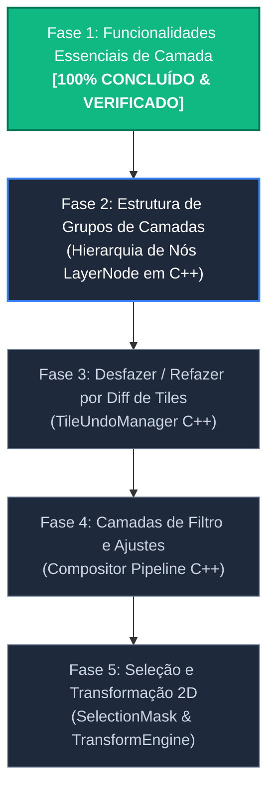

# Implementation Plan — Roadmap de Desenvolvimento: ALADYN ENGINE + LUMENIA UI

Este plano estabelece o **Roadmap Arquitetural e Funcional** para o motor C++ nativo (**`ALADYN ENGINE`**) e a interface de usuário (**`Lumenia UI`**).

---

## Status do Projeto & Progresso Atual

---

## 🟢 FASE 1 — Funcionalidades Essenciais de Camada & UI (`LayerStack` C++ & `LayersPanel` UI)
> **STATUS: 100% CONCLUÍDO & VERIFICADO**

1. **Refatoração da Arquitetura `PixelContext` nos 8 Mini-Motores C++**:
   - Refatoradas as classes `PencilEngine`, `InkerEngine`, `MarkerEngine`, `OilImpastoEngine`, `WatercolorEngine`, `EraserEngine`, `BlurEngine` e `SmudgeEngine` para consumirem a estrutura `const raster::PixelContext& ctx`.
   - O `DabRenderer::renderDab` injeta o contexto de renderização completo (máscara de recorte, alvos de mistura, alpha lock e clipping mask) para cada dab processado.

2. **Alpha Lock (`set_layer_alpha_lock`)**:
   - **[C++ Engine]**: Preserva o canal alpha original do pixel alvo `dst.a` durante a aplicação de dabs.
   - **[UI Lumenia]**: Totalmente conectado e sincronizado via `LayersPanel` e `AladynBackend`.

3. **Clipping Mask (`set_layer_clipping_mask`)**:
   - **[C++ Engine]**: O `Compositor.cpp` e o `PixelContext` utilizam a camada base visível como máscara multiplicativa no tempo real de desenho e na composição final.
   - **[UI Lumenia]**: Totalmente conectado e sincronizado com resposta em tempo real.

4. **Mesclar para Baixo (`merge_layer_down`)**:
   - **[C++ Engine]**: Método `mergeLayerDown(int index)` compõe os pixels entre a camada superior e inferior e remove a camada mesclada.
   - **[UI Lumenia]**: Conectado ao botão e atalho do painel de camadas.

5. **Sincronização de Drag & Drop em Tempo Real (`reorder_layers`)**:
   - **[C++ Engine]**: Criado `reorderLayers(const std::vector<int>& newOrder)` no C++ e exposto no PyBind11.
   - **[UI Lumenia]**: O evento `order_changed` do `LocalLayerManager` reordena atomicamente a pilha física de camadas no C++ ao arrastar e soltar itens na lista.

6. **Refinamento Ergonômico da UI (`LayersPanel` / `LayerItemDelegate`)**:
   - Reorganizado o layout dos itens em **2 linhas horizontais** à direita do preview.
   - Removida a borda nativa branca do Windows (`setAllColumnsShowFocus(False)` e `Qt.NoFocus`).
   - Padronizados os 3 ícones de status (`Clip Mask`, `Alpha Lock`, `Lock Layer`) com opacidade de 35% no estado inativo.
   - Reorganizada a barra lateral primária de atalhos (`LayersPrimaryBox`).

---

## 🟡 FASE 2 — Estrutura Hierárquica e Grupos de Camadas (`LayerGroup` C++)
> **STATUS: PRÓXIMA ETAPA (EM PLANEJAMENTO)**

*Foco: Transformar a `LayerStack` C++ de uma lista plana para uma árvore hierárquica completa para suporte a Grupos de Camadas.*

1. **Estrutura de Nós Hierárquicos (`LayerNode`)**:
   - **[C++ Engine]**: Criar a classe abstrata `LayerNode` (com propriedades comuns de visibilidade, opacidade, nome, lock) e derivar `DrawingLayer` e `LayerGroup`.
   - **[C++ Engine]**: O `LayerGroup` armazenará um `std::vector<std::unique_ptr<LayerNode>>`.
2. **Composição de Grupos (`Pass-Through` vs `Isolated Group`)**:
   - **[C++ Engine]**: Atualizar o `Compositor.cpp` para realizar composição recursiva em sub-buffers temporários para grupos isolados.
3. **Ponte e UI**:
   - **[UI Lumenia]**: Expandir o `LayerModel` (`QAbstractItemModel`) para sincronizar a criação, colapso (`ROLE_COLLAPSED`) e movimentação de sub-camadas dentro e fora de grupos com o C++.

---

## 🔵 FASE 3 — Sistema de Desfazer/Refazer por Diffs de Tiles (`TileUndoManager` C++)
> **STATUS: PLANEJADO**

*Foco: Histórico de desfazer/refazer ilimitado com consumo mínimo de memória RAM.*

1. **Captura de Diffs por Traço**:
   - **[C++ Engine]**: Criar o `TileUndoManager` em C++. A cada finalização de traço (`end_stroke`), capturar cópias dos tiles modificados através do `SpatialCuller`.
   - **[C++ Engine]**: Expor `undo()` e `redo()` na `PaintEngineFacade`.
2. **UI & Atalhos**:
   - **[UI Lumenia]**: Conectar atalhos `Ctrl+Z` e `Ctrl+Y` / `Ctrl+Shift+Z`.

---

## 🟣 FASE 4 — Camadas de Filtro e Ajustes Nativos (`FilterLayer` C++)
> **STATUS: PLANEJADO**

*Foco: Filtros procedurais e não-destrutivos no pipeline de composição C++.*

1. **Pipeline de Efeitos Nativos**:
   - **[C++ Engine]**: Criar a classe `FilterLayer` derivada de `LayerNode`. Executa filtros em tempo real no compositor:
     - Matiz / Saturação / Luminosidade (HSV);
     - Brilho & Contraste;
     - Desfoque Gaussiano (via convolução otimizada).
2. **UI**:
   - **[UI Lumenia]**: Diálogo de parâmetros de filtro com visualização prévia no canvas.

---

## 🔴 FASE 5 — Seleção e Transformação Livre 2D (`SelectionMask` & `TransformEngine`)
> **STATUS: PLANEJADO**

*Foco: Ferramentas de seleção de pixels e transformação geométrica.*

1. **Máscara de Seleção 8-bit (`SelectionMask`)**:
   - **[C++ Engine]**: Suporte a máscaras de seleção (Retângulo, Elipse, Laço, Varinha Mágica).
2. **Transformação Livre 2D (`TransformEngine`)**:
   - **[C++ Engine]**: Mover, Rotacionar, Escalar e Distorcer áreas selecionadas com interpolação de pixels.

---

## Verification Plan

### Automated Verification
- Scripts de diagnóstico Python offscreen para validação de cada nova API C++.
- Garantia de tempo de resposta por frame < 16ms.

### Manual Verification
- Teste interativo contínuo no app **Lumenia** cobrindo traços de pincel, manipulação de camadas e gerenciamento de grupos.
