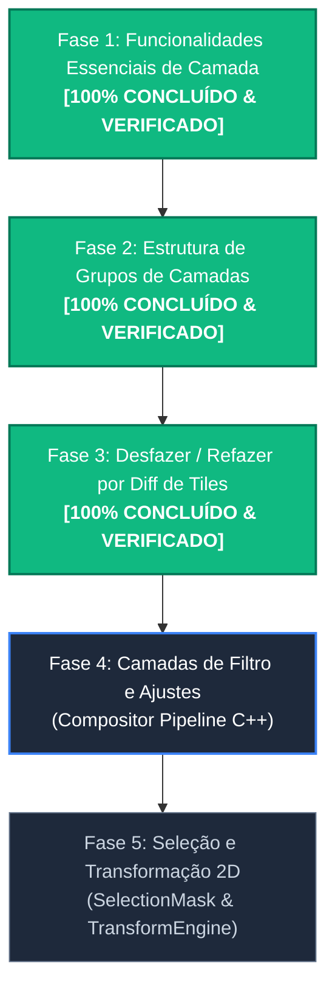

# Implementation Plan — Roadmap de Desenvolvimento: ALADYN ENGINE + LUMENIA UI

Este plano estabelece o **Roadmap Arquitetural e Funcional** para o motor C++ nativo (**`ALADYN ENGINE`**) e a interface de usuário (**`Lumenia UI`**).

---

## Status do Projeto & Progresso Atual

---

## 🟢 FASE 1 — Funcionalidades Essenciais de Camada & UI (`LayerStack` C++ & `LayersPanel` UI)
> **STATUS: 100% CONCLUÍDO & VERIFICADO**

1. **Refatoração da Arquitetura `PixelContext` nos 8 Mini-Motores C++**:
   - Refatoradas as classes `PencilEngine`, `InkerEngine`, `MarkerEngine`, `OilImpastoEngine`, `WatercolorEngine`, `EraserEngine`, `BlurEngine` e `SmudgeEngine` para consumirem a estrutura `const raster::PixelContext& ctx`.
   - O `DabRenderer::renderDab` injeta o contexto de renderização completo (máscara de recorte, alvos de mistura, alpha lock e clipping mask) para cada dab processado.

2. **Alpha Lock (`set_layer_alpha_lock`)**:
   - Preserva o canal alpha original durante a aplicação de dabs. Conectado e sincronizado via UI.

3. **Clipping Mask (`set_layer_clipping_mask`)**:
   - O `Compositor.cpp` e o `PixelContext` utilizam a camada base visível como máscara multiplicativa em tempo real.

4. **Mesclar para Baixo (`merge_layer_down`)**:
   - Método `mergeLayerDown(int index)` compõe os pixels entre as camadas e atualiza a estrutura física.

5. **Sincronização de Drag & Drop em Tempo Real (`reorder_layers`)**:
   - Reordena atomicamente a pilha física de camadas no C++ e na interface.

---

## 🟢 FASE 2 — Estrutura Hierárquica e Grupos de Camadas (`LayerGroup` C++)
> **STATUS: 100% CONCLUÍDO & VERIFICADO**

1. **Estrutura de Nós Hierárquicos (`LayerNode`)**:
   - Classe `LayerNode` com derivação para `Layer` de desenho e `GroupLayer`.
   - Hierarquia gerenciada via ponteiros de grupo/pai (`set_layer_parents`).
2. **Sincronização de Visibilidade, Opacidade e Fusão de Grupos**:
   - Opacidade e visibilidade de grupos sincronizadas recursivamente em tempo real para todas as camadas filhas.
   - Suporte a achatamento de grupos (`flattenGroup`) e mesclagem total para baixo (`mergeLayerDown` para grupos/camadas), destruindo o nó do grupo e cozendo os pixels.

---

## 🟢 FASE 3 — Sistema de Desfazer/Refazer por Diffs de Tiles (`TileUndoManager` C++)
> **STATUS: 100% CONCLUÍDO & VERIFICADO**

1. **Captura de Diffs por Traço (`TileUndoManager`)**:
   - Classe `TileUndoManager` em C++ registrando os estados prévio (`beforeData`) e posterior (`afterData`) dos tiles de $128 \times 128$ pixels modificados durante cada traço ou ação de limpeza.
   - Consumo otimizado de memória RAM com descarte automático de tiles sem alterações.
2. **Interface & Atalhos Globais**:
   - Botões vetoriais **Desfazer (Undo)** e **Refazer (Redo)** expostos na `ToolSidebar`.
   - Atalhos universais `Ctrl+Z`, `Ctrl+Y` e `Ctrl+Shift+Z` integrados.

---

## 🟡 FASE 4 — Camadas de Filtro e Ajustes Nativos (`FilterLayer` C++)
> **STATUS: PRÓXIMA ETAPA (EM PLANEJAMENTO)**

*Foco: Filtros procedurais e não-destrutivos no pipeline de composição C++.*

1. **Pipeline de Efeitos Nativos**:
   - **[C++ Engine]**: Criar a classe `FilterLayer` derivada de `LayerNode`. Executa filtros em tempo real no compositor:
     - Matiz / Saturação / Luminosidade (HSV);
     - Brilho & Contraste;
     - Desfoque Gaussiano (via convolução otimizada).
2. **UI**:
   - **[UI Lumenia]**: Diálogo de parâmetros de filtro com visualização prévia no canvas.

---

## 🔴 FASE 5 — Seleção e Transformação Livre 2D (`SelectionMask` & `TransformEngine`)
> **STATUS: PLANEJADO**

*Foco: Ferramentas de seleção de pixels e transformação geométrica.*

1. **Máscara de Seleção 8-bit (`SelectionMask`)**:
   - **[C++ Engine]**: Suporte a máscaras de seleção (Retângulo, Elipse, Laço, Varinha Mágica).
2. **Transformação Livre 2D (`TransformEngine`)**:
   - **[C++ Engine]**: Mover, Rotacionar, Escalar e Distorcer áreas selecionadas com interpolação de pixels.

---

## Verification Plan

### Automated Verification
- Scripts de diagnóstico Python offscreen para validação de cada nova API C++.
- Garantia de tempo de resposta por frame < 16ms.

### Manual Verification
- Teste interativo contínuo no app **Lumenia** cobrindo traços de pincel, manipulação de camadas e gerenciamento de grupos.
